<a href="docs/img/hero.png" title="Open the full dashboard screenshot">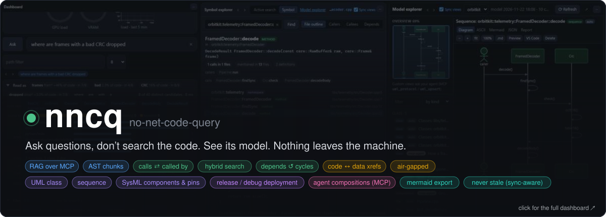</a>

# no-net-code-query (nncq)

**Ask questions, don't search the code. See its model. Nothing leaves the machine.**

**[Try the live demo at chrisgriffis.rocks](https://chrisgriffis.rocks)**: the dashboard on the bundled sample codebase, read-only, nothing to install. Agents can connect to its MCP endpoint, `https://chrisgriffis.rocks/mcp`.

nncq is a local code index for you and your coding agent. Search gives you lines that match a string; nncq gives the agent the structure of the codebase: whole functions and classes, who calls what, how execution gets from A to B, what depends on what, what breaks if X changes and, with a [codebase profile](#codebase-profiles), which data files use which code. It draws the same index as UML / SysML diagrams that stay in step with the code, and lets agents add their own. No build, no IDE index, no cloud: everything runs on your machine.

- **For your agent** (Copilot CLI, Claude Code, Visual Studio, anything that speaks MCP): `ask` returns a short map instead of ten code dumps; graph tools trace callers, call paths, dependencies and blast radius with `file:line`; `uml_*` tools draw and author diagrams. Every answer is sized for an agent's context (a few KB).
- **For you**: a three-pane dashboard at `http://127.0.0.1:8765/`: Ask, a Symbol explorer and a Model explorer, kept in sync.
- **Offline and private**: the network is used only by `init`. The server binds to `127.0.0.1`. One index per person, matching what they have synced.
- **Lite or full**: lite runs anywhere (keywords + graph + model, ~150 MB, no GPU); full adds NVIDIA-GPU embeddings and a reranker for questions that share no words with the code.

<a href="docs/img/hero.png">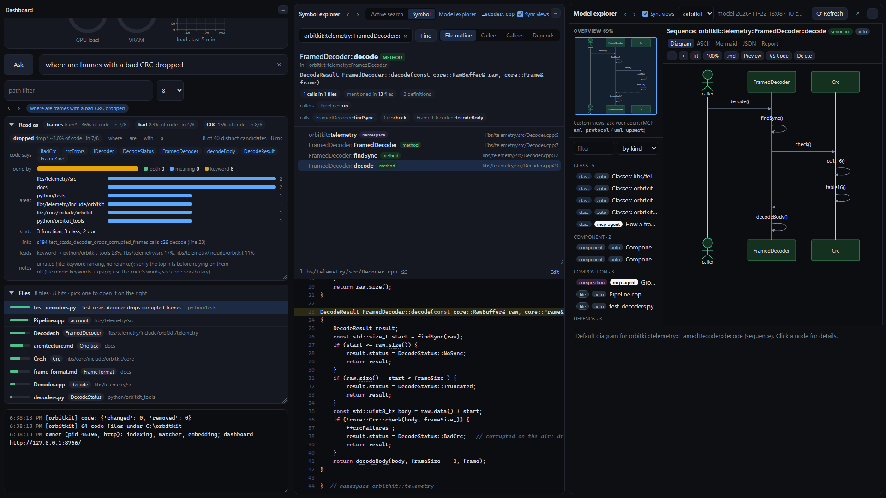</a>
<sub>The three panes on the bundled demo (`demo/orbitkit`, a fictional satellite ground-station toolkit, lite mode): a question answered on the left, the symbol it led to in the middle, its generated sequence diagram on the right.</sub>

> **Status:** indexing (tree-sitter + profile-declared DSLs, data cross-reference), hybrid search, the graph tools, the UML / SysML model and Model explorer, codebase profiles, the MCP server, the dashboard and the CLI are in and tested; developed against a 4,000-file slice of a large C++ workspace and the bundled demo. Not yet: Linux `init.sh`, editor plugins.

## Contents

| Start | Use | Understand |
|---|---|---|
| [Quick start (Windows)](#quick-start-windows) | [What it gives an agent](#what-it-gives-an-agent) | [The symbol graph without a build](#the-symbol-graph-how-does-it-know-that-without-a-build) |
| &nbsp;&nbsp;[Try it on the demo](#try-it-on-the-bundled-demo) | &nbsp;&nbsp;[Graph tools](#graph-tools) | [The UML / SysML model](#the-uml--sysml-model) |
| &nbsp;&nbsp;[Index your own code](#index-your-own-code) | &nbsp;&nbsp;[UML tools](#uml-tools-and-diagrams-for-agents) | [Never stale: sync propagation](#never-stale-staleness-and-sync-propagation) |
| [Modes: full and lite](#modes-full-and-lite) | [The dashboard](#the-dashboard) | [Design](#design) and [design choices](#design-choices-and-why) |
| [Codebase profiles](#codebase-profiles) | &nbsp;&nbsp;[Ask](#ask) · [Symbol explorer](#symbol-explorer) · [Code view and editor](#code-view-and-editor) | [Why each tool is used](#why-each-tool-is-used) |
| [Agent setup](#agent-setup-nncq-agents) | &nbsp;&nbsp;[Model explorer](#model-explorer) | [GPU use during indexing](#gpu-use-during-indexing-on-demand-interruptible) |
| [Configuration (`.env`)](#configuration-env) | [Exports: Markdown, Mermaid, ASCII](#exports-markdown-mermaid-ascii) | [Local only and air-gapped](#local-only-and-air-gapped) |

Also: [Why not just Copilot + Visual Assist?](docs/why-nncq.md) · [Ideas not built yet](docs/ideas.md) · [Requirements and cost](#requirements-and-cost) · [Tests and tools](#tests-and-tools) · [Limitations](#limitations) · [Roadmap](#roadmap)

---

## Quick start (Windows)

```powershell
git clone <this repo> nncq; cd nncq
.\init.ps1 -Lite                 # lite: venv, no torch, no models, no GPU; interactive .env, agent setup
.\init.ps1                       # or full: + CUDA torch and the two models (~14 GB)
```

`init` asks a few questions (port, mode, ...), writes `.env`, fetches the parsers and a pinned, sha256-verified Mermaid build, links a [codebase profile](#codebase-profiles) to a workspace and offers to set up the agents it finds ([`nncq agents`](#agent-setup-nncq-agents)). Then start your agent: it launches nncq over stdio itself, and the dashboard comes up on first visit. `nncq start` runs a standalone HTTP server instead, for several clients at once.

### Try it on the bundled demo

`demo/orbitkit` is a small, fictional, original codebase made for this: a satellite ground-station toolkit with four C++ libraries, a daemon, tests, Debug / Release configurations and presets, an aarch64 toolchain, a Python tools package, docs, an inheritance hierarchy three levels deep, composition and aggregation, a call chain from `main` to a CRC check, and a deliberate include cycle. Every screenshot in this README is of it.

A read-only copy runs at **https://chrisgriffis.rocks** (the `Dockerfile`, redeployed from master by `.github/workflows/deploy.yml`); its MCP endpoint is `https://chrisgriffis.rocks/mcp`. To point an agent at it, add it as an HTTP MCP server, e.g. in `~/.copilot/mcp-config.json`:

```json
{ "mcpServers": { "nncq-demo": { "type": "http", "url": "https://chrisgriffis.rocks/mcp", "tools": ["*"] } } }
```

The first request after a quiet spell takes 10-20 s while the container starts.

Double-click `demo\demo.cmd` (Linux / macOS: `demo/demo.sh`). The first run installs nncq into `.venv` in lite mode (no torch, no GPU, about 150 MB); every run indexes the demo (a second or two), starts the server and opens the dashboard on http://127.0.0.1:8766/. Close the window to stop it.

`demo/` is a self-contained nncq home: its own profile (`demo/profiles/orbitkit`), settings (`demo/.env`: lite, port 8766), index and logs (`demo/cache`). It never touches your profiles or indexes and runs next to a real server on 8765. Any nncq command works on it with `--home demo`, e.g. `.venv\Scripts\nncq --home demo graph trace Crc::check --from main`. On the first run `demo/seed_model.py` talks to the server over MCP exactly like an agent: it generates a set of diagrams and upserts one view and one composition with provenance (`copilot-cli`, `claude-opus-5.5`), so the `mcp-agent` badge has something to show. See [demo/README.md](demo/README.md).

### Index your own code

```powershell
.venv\Scripts\nncq profile new myapp D:\src\myapp     # wizard: roots, markers, code folders, ignores, VCS
.venv\Scripts\nncq index --name myapp                  # T0 parse (+ data xref if the profile has rules); full mode embeds alongside
.venv\Scripts\nncq index D:\src\other --dirs src,tools # or ad hoc, without a profile
```

Day to day: the server's watcher re-indexes on save; `nncq update` catches up after a sync (only files whose content changed are re-parsed); `nncq status`, `nncq pause` / `nncq resume` (embedding), `nncq stop`.

### Modes: full and lite

| | full (default) | lite (`-Lite`, `NNCQ_MODE=lite`) |
|---|---|---|
| Install | ~14 GB (CUDA torch, two 1B models) | ~150 MB |
| Hardware | NVIDIA GPU (8 GB+) | any machine |
| Indexing | T0 parse, then GPU embedding (~20 min per 40k chunks) | T0 parse only (minutes) |
| Search | keywords + meaning + reranker | keywords (sub-word identifiers, stems) |
| Graph, `depends`, data cross-reference, `ask` / `expand`, UML model and diagrams, dashboard | yes | yes, identical |
| Match strength in `ask` | strong / fair / weak | `unrated`: verify top hits |

Lite is the coworker default: the graph tools, the model and the data cross-reference need no GPU and carry most of the value for structural questions. What lite loses is "find code that does X" when the question shares no words with the code; the agent compensates partly by re-asking with the `code_vocabulary` that `ask` returns. Upgrading is in place: run `.\init.ps1` without `-Lite` (installs the `gpu` extra and the models, sets `NNCQ_MODE=full`), and the worker embeds the existing index. Nothing is re-parsed.

### Codebase profiles

nncq's code knows no particular codebase. Everything specific to one lives in a profile, `profiles/<name>/profile.toml`: one profile, one workspace, one index. `profiles/*` is git-ignored except the documented [template](profiles/_template/profile.toml) (the demo's profile lives in its own home: [demo/profiles/orbitkit](demo/profiles/orbitkit/profile.toml)), so a profile can name private repos, paths and file formats while this repo stays shareable. A profile declares:

- **Where the workspace is** on this machine: candidate roots, marker files that must exist, optionally a substring of the git remote. The first candidate that passes wins; `NNCQ_WORKSPACE_<NAME>` overrides. Workspaces live outside the nncq folder (the bundled demo under `demo/` excepted); a relative root is relative to the home folder.
- **What to index:** code folders, extra ignores, extra file extensions and non-code formats.
- **Version control** (`vcs = "git" | "p4" | "none"`, proposed by the wizard, detected at run time when absent): which actions the dashboard's editor offers (git stage / revert; p4 edit / revert, Save checks a read-only p4 file out first; none: just Save).
- **Definition languages** (`[[dsl]]`): brace-block IDL / schema / service files, chunked at declarations, with `name : Base` inheritance.
- **Data cross-reference** (`[[xref]]`): a glob for data files plus regexes with named groups, `instance` (`type`: a code type the file instantiates) and `reference` (`ref`: another data file), with `type_suffix` and `label`. Only then do the data tools exist (`data_for_code`, `code_for_data`, `data_file`, `hot_data`; CLI `nncq data uses|code|file|top`).
- **MCP notes:** vocabulary and conventions, appended to the server instructions agents see.

```powershell
nncq profile list                       # profiles, and the workspace each found on this machine
nncq profile new myapp D:\src\myapp     # wizard (nncq init runs it too: pick or create a profile)
nncq profile show myapp
nncq profile export myapp               # one compressed profiles\archive\myapp-<time>.nncqprofile
nncq profile import profiles\archive\myapp-<time>.nncqprofile [--as name] [--force]
```

`profiles/archive/` is tracked but its contents are git-ignored: export there, copy the file to another machine, import, and the profile finds its workspace again through its linking rules. An LLM agent running `nncq init`, or asked to write a profile from the template, can fill in the DSL and xref rules from a plain description of the codebase.

### Agent setup: `nncq agents`

`init` detects the agents on the machine and offers to set each up; `nncq agents` (or `init.ps1 -Agents copilot,claude,vs`) does it again at any time. Per agent it registers nncq as a stdio MCP server and installs two skills: [`nncq-user`](nncq-user.skill.md) (investigate with several narrow `ask`s, connect hits with the graph tools, `expand` only what the answer rests on, reply with one digest) and, when the UML model is on, [`nncq-uml-modeler`](nncq-uml-modeler.skill.md) (generate, recall and author diagrams and compositions). Both are terse summaries; the tools' own descriptions and `uml_protocol` stay authoritative.

| Agent | MCP server | Skills |
|---|---|---|
| Copilot CLI | `~/.copilot/mcp-config.json` | `~/.copilot/skills/nncq-user/SKILL.md`, `.../nncq-uml-modeler/SKILL.md` |
| Claude Code | `claude mcp add --scope user nncq ...` | `~/.claude/skills/nncq-user/SKILL.md`, `.../nncq-uml-modeler/SKILL.md` |
| Visual Studio (Copilot agent mode) | `%USERPROFILE%\.mcp.json` | no global location: paste into custom instructions |

Existing config files are merged (a `.bak-nncq` copy is kept); the workspace is never written to. A short version of the skills also goes to every client in the MCP server instructions, so agents without them still get the gist. `nncq mcp-config` prints the raw entries for anything else.

---

## What it gives an agent

| MCP tool | Answers |
|---|---|
| `ask` | **Start here.** A question in plain words returns a short generated map, not code: how the question was read, what the hits cover, one line of facts per hit, and how the hits call each other. Each hit has a ref to dig into. [Why](#ask-not-search) |
| `expand` | Dig into `ask` refs (or `path:start-end`, resolved to its enclosing symbol): exact code, symbol card, callers, callees or file outline |
| `more` | The rest of an answer that was trimmed to fit (`paged` gives the cursor) |
| `search_code` | Raw hybrid search (keywords plus meaning plus reranker). Whole functions or classes as code blocks |
| `grep_code` | Exact text or regex matches (ripgrep, honours `.gitignore` / `.p4ignore`) |
| `find_symbol`, `file_outline`, `find_references`, `read_code` | Where something is defined; the symbols in a file with line ranges; callers, subclasses and mentions of a name; an exact line range from disk |
| `symbol_context`, `calls`, `called_by`, `call_tree`, `call_trace`, `impact`, `type_hierarchy`, `depends`, `file_context`, `hotspots` | The symbol graph, [see below](#graph-tools) |
| `uml_view`, `uml_views`, `uml_find`, `uml_upsert`, `uml_delete`, `uml_protocol`, `uml_build` | UML / SysML diagrams and compositions, [see below](#uml-tools-and-diagrams-for-agents) |
| `data_for_code`, `code_for_data`, `data_file`, `hot_data` | Code ↔ data files; registered only when a workspace's profile declares `[[xref]]` rules |
| `index_status`, `update_index` | Freshness, embedding progress, delta re-index |

**Search and the AST work together.** Every chunk is cut at a function or class boundary and carries its path, line range, symbol, kind and parent; every symbol is also a node in the graph. On the demo, "where are frames with a bad CRC dropped" leads to `FramedDecoder::decode` (`Decoder.cpp:23-42`); `call_trace` shows `main → Station::serve → Scheduler::tick → Pipeline::run → FramedDecoder::decode → Crc::check`; `depends` on `Tracker` finds the include cycle with `Scheduler.h`; `uml_view` draws any of it. Each step is a few hundred tokens of structured answer instead of thousands of tokens of file text.

### Graph tools

| Tool | What you get |
|---|---|
| `symbol_context` | One-call card. For a type: definitions, bases and base chains, derived types (same language), members, data types that use it. For a function: callers (ranked), callees (resolved when unique), overrides up and down the hierarchy. Plus how many files mention it and whether the name is ambiguous |
| `calls` | Everything a function calls, in source order, each resolved to its definition when the name is unique or defined in the caller's own class. Macros and plumbing are folded into one closing line |
| `called_by` | Every caller with `file:line`, ranked same class > code mentions the class > `[by name]`; `xN` call sites; `(test)` callers last |
| `call_tree` | Callers (`in`) or callees (`out`) as an indented tree, N levels deep, cycle-safe |
| `call_trace` | "How does execution get here?" as debugger-style pseudo stacks, walked back to entry points; or how two functions relate. Links matched by name alone are tagged `[calls X: N defs]`; a trail that goes cold says so |
| `impact` | Transitive callers summarised by folder and file: the blast radius before you change a signature |
| `depends` | Dependency graph of a type (inheritance, composition / aggregation / association, member / parameter / return types, creations) or of a file (`mode=include`: includes / imports), both directions, 1-3 hops, capped per node; cycles marked and not expanded |
| `type_hierarchy` | Base chains up and the derived tree down, in the type's language family |
| `file_context` | Outline, includes, who includes this file, which files it calls into or is called from |
| `hotspots` | Most-called functions, most-derived bases, biggest fan-out, most-included headers, largest functions, uncalled functions |

All caller and callee lookups stay inside the definition's language family (C/C++ together, JS/TS together), so a C++ `decode` is not "called" from the Python twin of the same decoder. Test and mock code is tagged and listed after production code.

### UML tools and diagrams for agents

| Tool | What it does |
|---|---|
| `uml_view(kind, subject, path, under, depth, format)` | A generated diagram: `class`, `object`, `component`, `package`, `deployment`, `sequence`, `depends`. Without a kind, the default diagram for a subject or path (type → class, function → sequence, file → file composition, folder → packages, nothing → components). `key=` returns a stored one |
| `uml_views(group_by, symbol)` | Stored diagrams and compositions, by kind, component / folder or origin; `symbol=X`: the ones that contain X |
| `uml_find(name)` | Element ids (`sym:`, `comp:`, `port:`, `pkg:`, `file:`, `cfg:`, `composition:`, `view:`) to reference |
| `uml_upsert(spec, model)` | Store an agent-authored view or composition; `model=` records provenance with the MCP client |
| `uml_delete`, `uml_protocol`, `uml_build` | Remove one (referrers get flagged); the authoritative schema, rules and examples; build the model when an index predates it |

`format=ascii` is for chat. This is what an agent gets for `uml_view(kind="class", subject="Pipeline")` on the demo:

```text
Classes: orbitkit::telemetry::Pipeline

+------------------------------------------------+  +--------------+  +---------------+  +----------+
| Pipeline                                       |  | <<abstract>> |  | <<interface>> |  | Clock    |
+------------------------------------------------+  | ISink        |  | IRadio        |  +----------+
| - radio_ : link::IRadio&                       |  +--------------+  +---------------+
| - decoder_ : std::unique_ptr<IDecoder>         |
| - sinks_ : std::vector<std::shared_ptr<ISink>> |
| - clock_ : core::Clock&                        |
| - scratch_ : core::RawBuffer                   |
| - stats_ : Stats                               |
+------------------------------------------------+
| + Pipeline(radio, decoder, clock)              |
| + addSink(sink) : void                         |
| + run(frameBudget) : std::size_t               |
| + reset() : void                               |
| - dispatch(packet) : void                      |
| - account(result, frame) : void                |
+------------------------------------------------+

+---------------+  +----------+
| <<interface>> |  | Stats    |
| IDecoder      |  +----------+
+---------------+

Relations:
  Pipeline ---> IRadio   radio_ [1]
  Pipeline *--> IDecoder   decoder_ [1]
  Pipeline o--> ISink   sinks_ [*]
  Pipeline ---> Clock   clock_ [1]
  Pipeline *--> Stats   stats_ [1]
  Pipeline <>-- Stats   nested
```

and for `uml_view(kind="component")`, SysML-style blocks with their pins (`o` provided: headers other components include, with how many; `(` required):

```text
Components: workspace

+-------------------------+  +-------------------------+  +--------------------+  +-----------------------+
| <<executable>>          |  | <<executable>>          |  | <<library STATIC>> |  | <<library STATIC>>    |
| orbit_tests             |  | groundd                 |  | orbit_core         |  | orbit_link            |
+-------------------------+  +-------------------------+  +--------------------+  +-----------------------+
| ( needs orbit_core      |  | ( needs orbit_core      |  | o Log.h (4)        |  | o Radio.h (3)         |
| ( needs orbit_link      |  | ( needs orbit_link      |  | o Clock.h (3)      |  | o LoopbackRadio.h (2) |
| ( needs orbit_sched     |  | ( needs orbit_sched     |  | o Crc.h (2)        |  | o SdrRadio.h (2)      |
| ( needs orbit_telemetry |  | ( needs orbit_telemetry |  | o Frame.h (2)      |  | o Antenna.h (2)       |
+-------------------------+  +-------------------------+  | o RingBuffer.h (1) |  +-----------------------+
                                                          +--------------------+  | ( needs orbit_core    |
                                                                                  +-----------------------+

+-------------------------+  +----------------------+  +------------------------+  +-------------+
| <<library STATIC>>      |  | <<library STATIC>>   |  | <<package>>            |  | <<script>>  |
| orbit_sched             |  | orbit_telemetry      |  | orbitkit-tools         |  | orbit-tools |
+-------------------------+  +----------------------+  +------------------------+  +-------------+
| o Scheduler.h (2)       |  | o Pipeline.h (3)     |  | ( needs orbitkit_tools |  | (no ports)  |
| o Ephemeris.h (1)       |  | o CcsdsDecoder.h (1) |  +------------------------+  +-------------+
+-------------------------+  +----------------------+
| ( needs orbit_core      |  | ( needs orbit_core   |
| ( needs orbit_link      |  | ( needs orbit_link   |
| ( needs orbit_telemetry |  +----------------------+
+-------------------------+
(cut for the README: 3 more blocks, the Python package, its module and a script)
```

`format=markdown` returns a Mermaid block plus a list of the elements shown, each linking to its page in the dashboard; [exports](#exports-markdown-mermaid-ascii) shows two, rendered live by GitHub.

---

## The dashboard

One page, three panes: the **dashboard** (index status, the Ask box, answers, console) | the **Symbol explorer** (search hits or a symbol: card, call trees, dependencies, code) | the **Model explorer** (the diagrams; also on its own at `/views`).

- Each explorer collapses to a thin strip and expands from it; drag the gaps to resize; widths and collapse states are remembered. A link aimed at a collapsed explorer opens it by swapping it with the other one.
- **Sync views** (on by default): a symbol or file picked anywhere shows its default diagram in the Model explorer, an element picked in a diagram reveals its code in the Symbol explorer, and Back / Forward restore both together. Off, each explorer keeps its own history.
- The URL holds the state (`#q=…&s=…&m=…`), so a link reopens the same view; results are cached in the page, so going back is instant.

<a href="docs/img/sync.gif">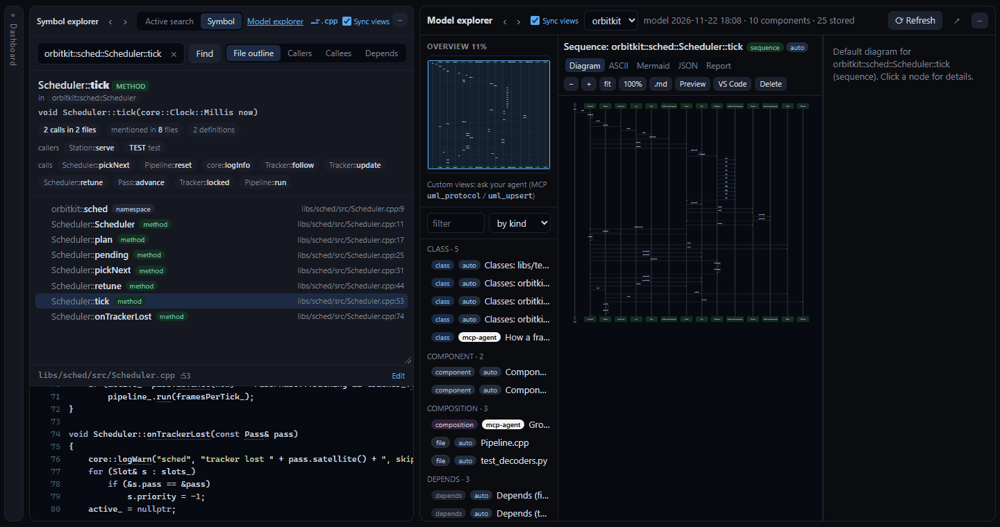</a>
<sub><b>Sync views</b> (dashboard pane collapsed): each symbol picked in the Symbol explorer brings its default diagram to the Model explorer: a function its sequence, a type its class view with the picked element's details.</sub>

<table>
<tr><td width="50%"><a href="docs/img/status.png">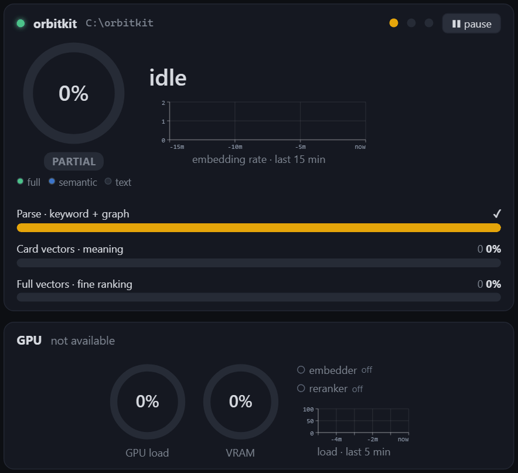</a><br><sub><b>Status.</b> The ring shows how much is searchable by meaning (lite mode: text only, by design), the bars the three index tiers, the chart the embedding rate; GPU and model state underneath.</sub></td>
<td width="50%"><a href="docs/img/ask.png">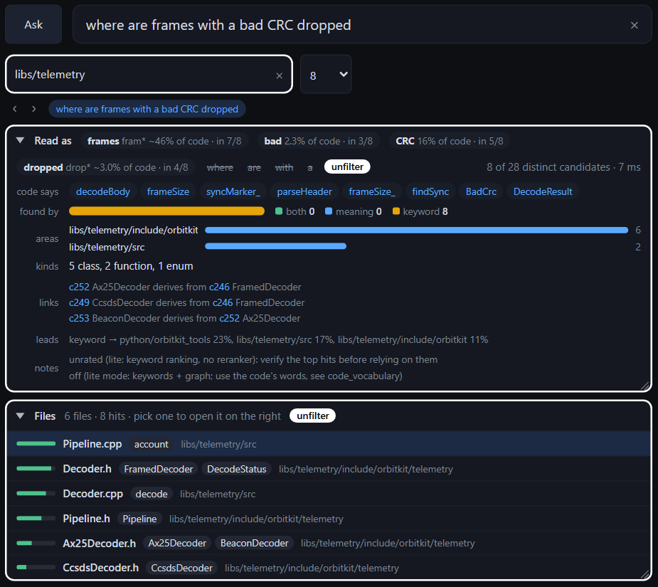</a><br><sub><b>Ask, with a path filter.</b> How the question was read (stems, share of code, ignored words, the code's own vocabulary, which channel found what, areas, links between hits), then the files. Panels the filter affects get a white outline and an <i>unfilter</i> button.</sub></td></tr>
</table>

### Ask

Two roll-ups per answer: how the question was read plus the portfolio, then the list of files. Picking a file opens its hits in the Symbol explorer (facts, then code with the matching lines highlighted). Numbers that change are drawn, not printed: rings and bars for progress, a stacked bar for which channel found the hits, bars for areas. Recent questions stay as chips under the box.

### Symbol explorer

<table>
<tr><td width="50%"><a href="docs/img/symbols-outline.png">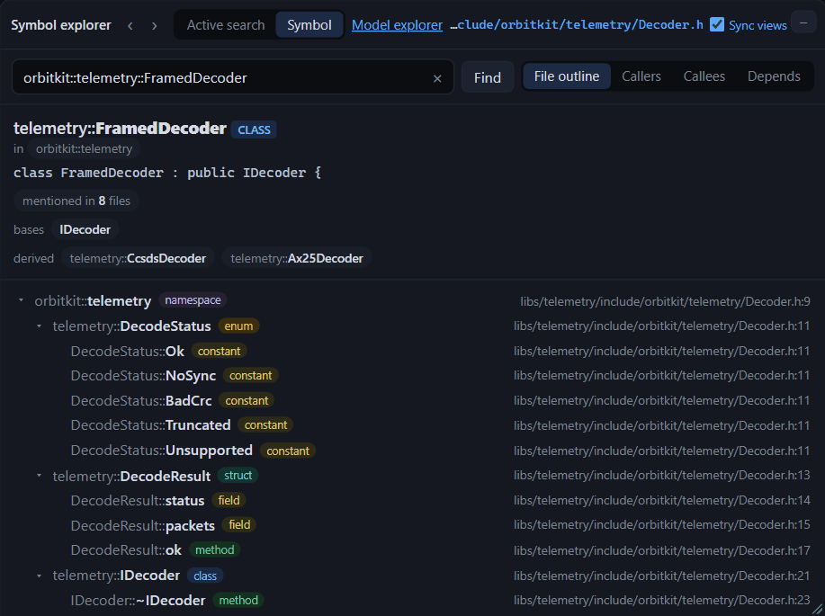</a><br><sub><b>File outline</b> (default): the symbol's card (signature, bases, derived types, callers, calls) and its file's outline.</sub></td>
<td width="50%"><a href="docs/img/symbols-callers.png">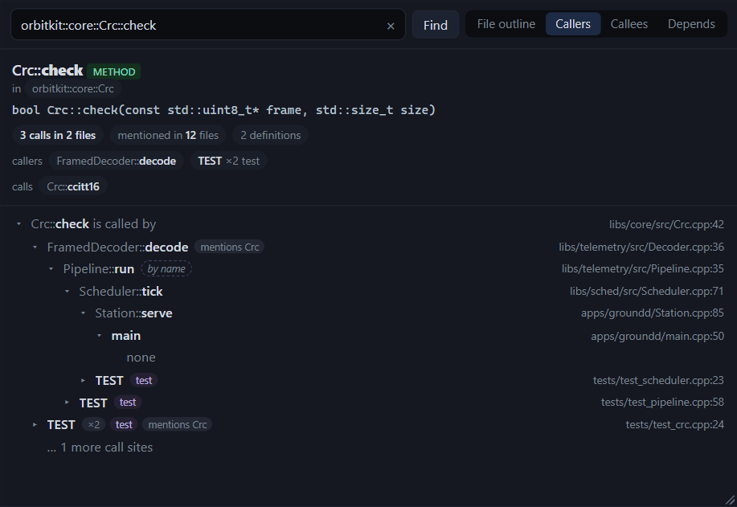</a><br><sub><b>Callers</b> of <code>Crc::check</code>, expanded up to <code>main</code>: ranked, <i>by name</i> links flagged, tests tagged. <b>Callees</b> works the same way down.</sub></td></tr>
<tr><td width="50%"><a href="docs/img/symbols-depends.png">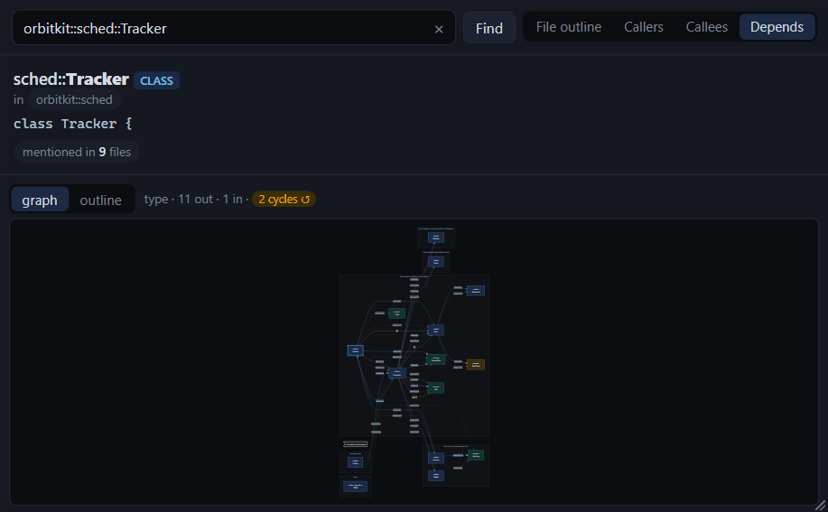</a><br><sub><b>Depends</b> as a thumbnail of the generated dependency graph (a click opens it in the Model explorer)…</sub></td>
<td width="50%"><a href="docs/img/symbols-depends-outline.png">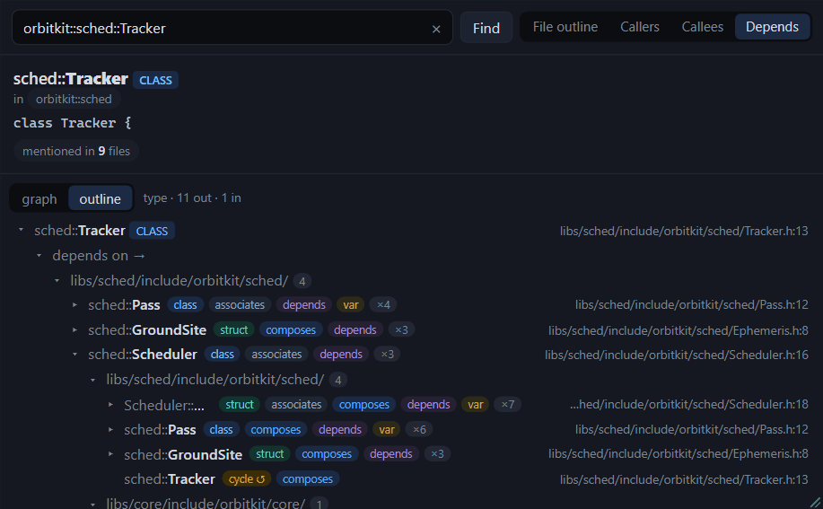</a><br><sub>…or as an outline grouped by folder, with relation badges; expanding <code>Scheduler</code> reaches <code>Tracker</code> again: <i>cycle ↺</i>.</sub></td></tr>
</table>

### Code view and editor

<table>
<tr><td width="50%"><a href="docs/img/code.png">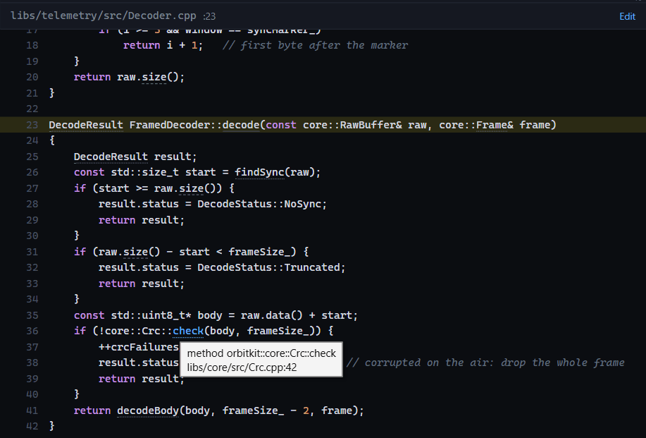</a><br><sub>Every known symbol in the code is a link (definition, call, type); hovering shows where it goes.</sub></td>
<td width="50%"><a href="docs/img/editor.png">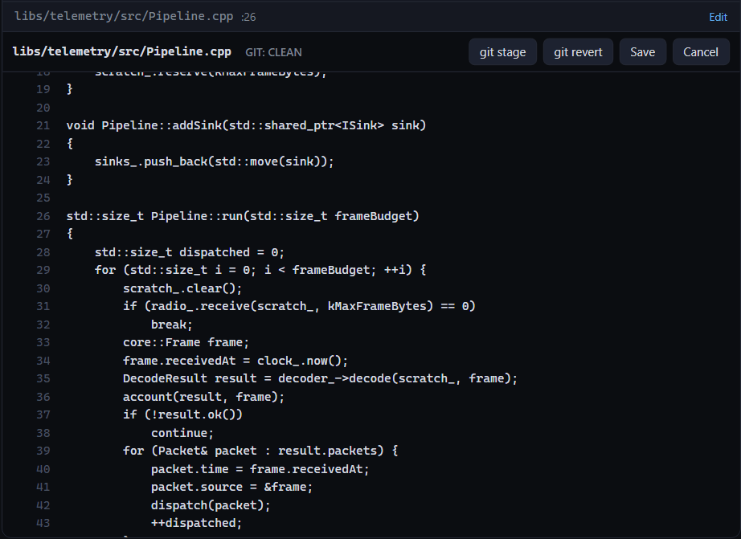</a><br><sub><b>Edit</b> turns it into an editor with the workspace's VCS actions (here git; p4 edit / revert for Perforce). Loopback only, on an explicit click; MCP never writes.</sub></td></tr>
</table>

### Model explorer

A grouped list of stored diagrams with colour-coded kind and origin badges (`auto`, `mcp-agent`, `user`), an overview minimap, pan / zoom (wheel at the cursor, drag, fit, 100%, keys `+ - 0 1`), Mermaid rendering in a palette by element kind, and a side panel for the picked element: location, relations, members, callers / callees, source, and buttons to reveal, open or edit the file.

<a href="docs/img/model-class.png">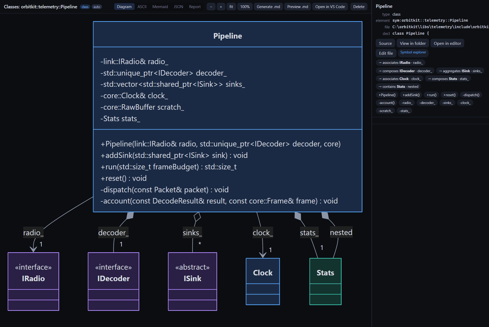</a>
<sub><b>Class view</b> of <code>Pipeline</code>: members with visibility, <i>composes</i> <code>IDecoder</code> (<code>unique_ptr</code>), <i>aggregates</i> <code>ISink</code> (<code>vector&lt;shared_ptr&gt;</code>, *), <i>associates</i> <code>IRadio</code> and <code>Clock</code> (references), the nested <code>Stats</code>; on the right, the picked node's element, relations and member chips.</sub>

<table>
<tr><td width="50%"><a href="docs/img/model-hierarchy.png">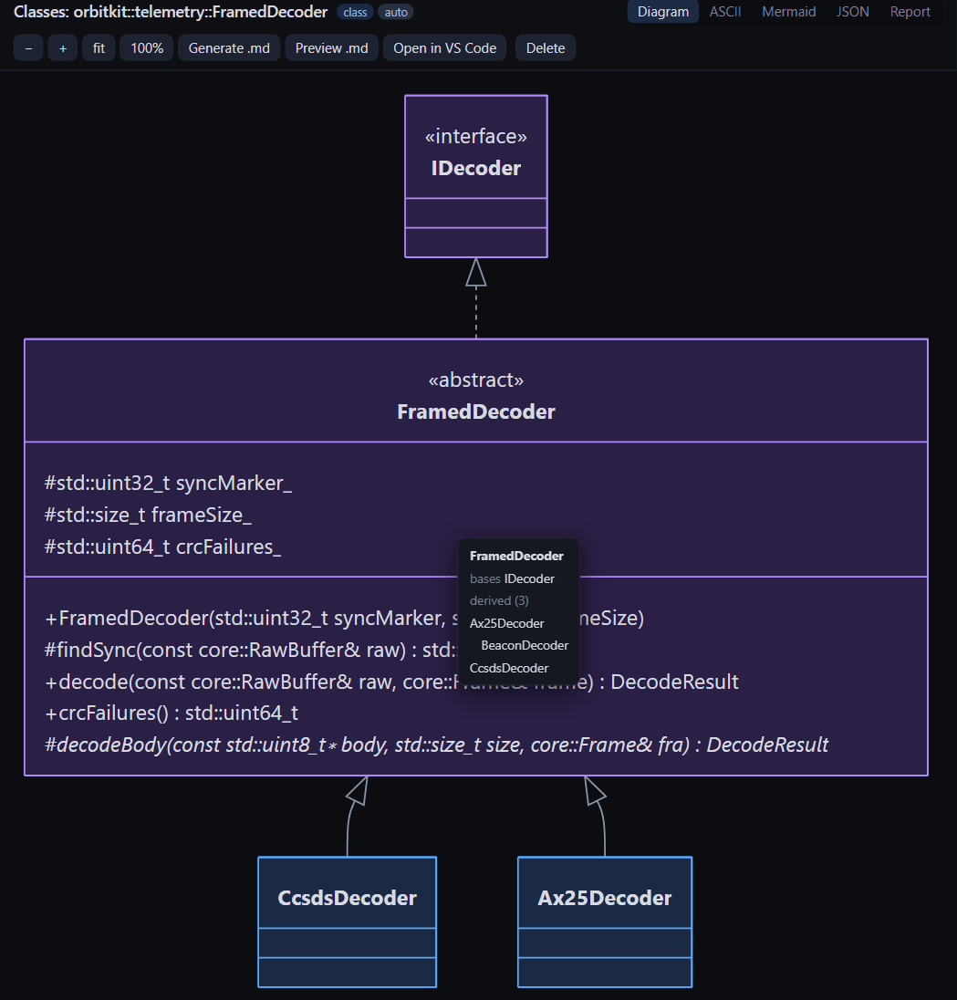</a><br><sub>Hovering a type in any diagram shows its inheritance: bases up, the derived tree down (C++ only: the Python twins with the same names are not mixed in).</sub></td>
<td width="50%"><a href="docs/img/model-agent.png">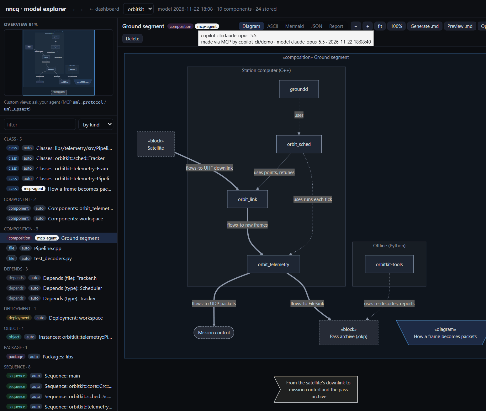</a><br><sub>A <b>composition made by an agent</b> over MCP: groups, generated components, bespoke parts and a nested diagram; the <code>mcp-agent</code> badge carries its provenance (client, model, time).</sub></td></tr>
</table>

<a href="docs/img/model-sequence.png">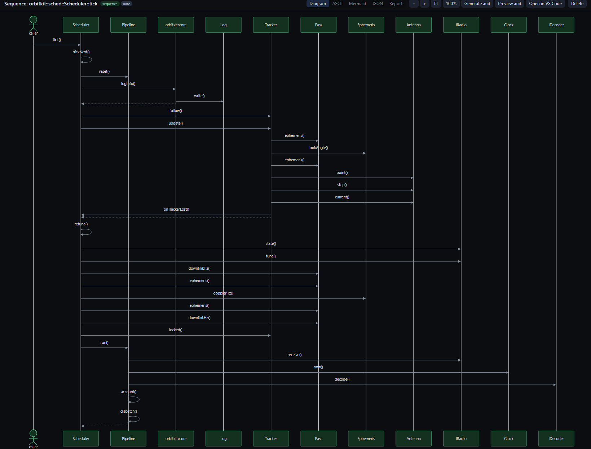</a>
<sub><b>Sequence</b> from <code>Scheduler::tick</code>, two calls deep, in source order: lifelines are classes or modules, receivers are typed through members, locals and qualifiers, self-calls loop back; every lifeline and message links to its code.</sub>

<table>
<tr><td width="50%"><a href="docs/img/model-component.png">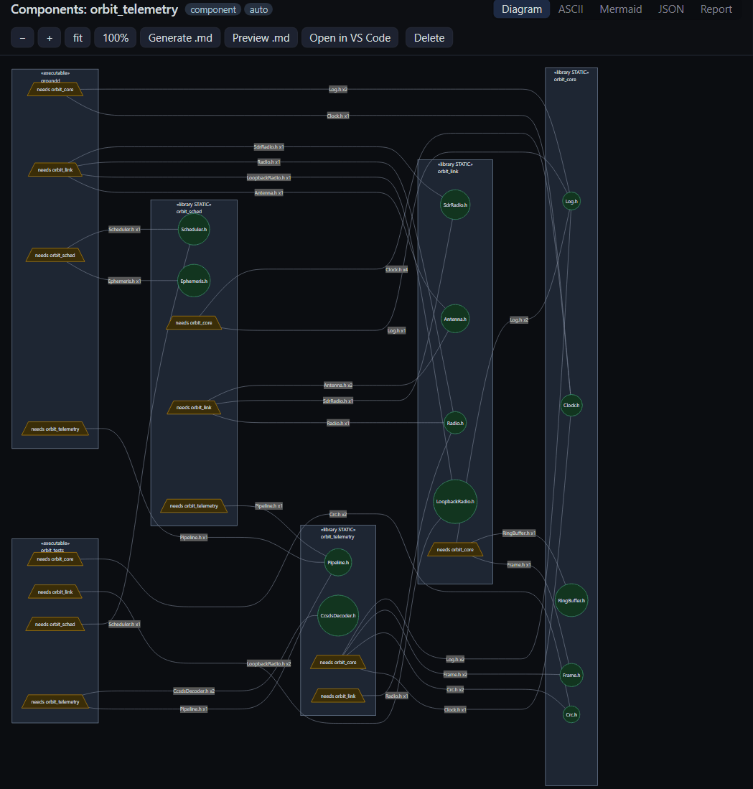</a><br><sub><b>Components</b> (SysML blocks) from CMake and Python packaging: provided pins (headers others include, circles), required pins (<code>needs …</code>), connectors labelled with what flows.</sub></td>
<td width="50%"><a href="docs/img/model-deployment.png">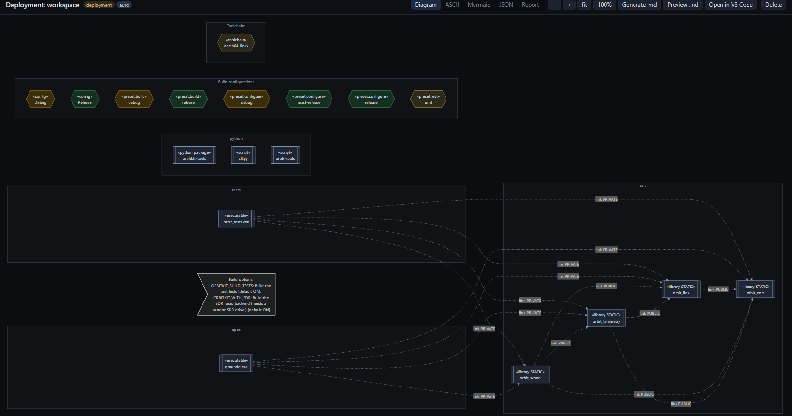</a><br><sub><b>Deployment</b>: executables, libraries, scripts and link dependencies (PUBLIC / PRIVATE), Debug / Release configurations, presets, the aarch64 toolchain, build options.</sub></td></tr>
<tr><td width="50%"><a href="docs/img/model-depends.png">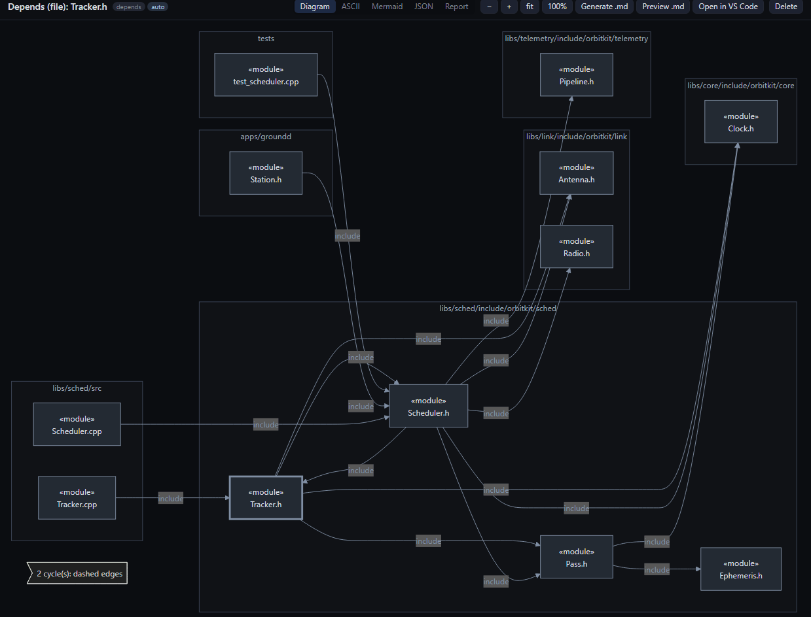</a><br><sub><b>Depends</b> of a file: includes both ways, grouped by folder; the <code>Tracker.h</code> ↔ <code>Scheduler.h</code> cycle is drawn dashed and counted.</sub></td>
<td width="50%"><a href="docs/img/model-file.png">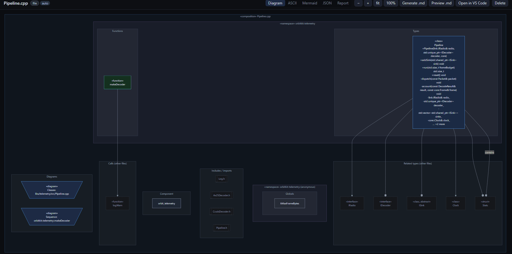</a><br><sub><b>File composition</b> of <code>Pipeline.cpp</code>, made on demand: its namespace with types and free functions, calls into other files, includes, globals, related types, its component and its sub-diagrams.</sub></td></tr>
<tr><td width="50%"><a href="docs/img/model-minimap.png">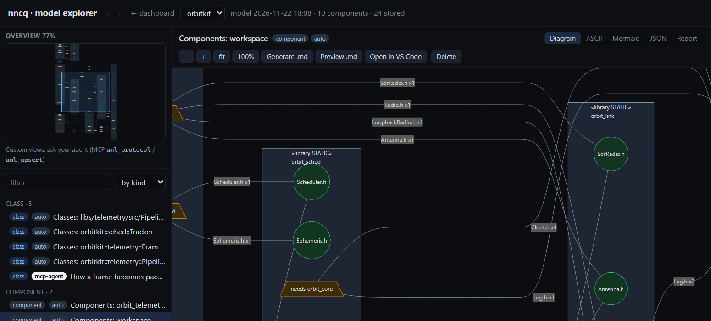</a><br><sub>Zoomed in: the <b>overview minimap</b> shows where you are; drag either one.</sub></td>
<td width="50%"><a href="docs/img/model-preview.png">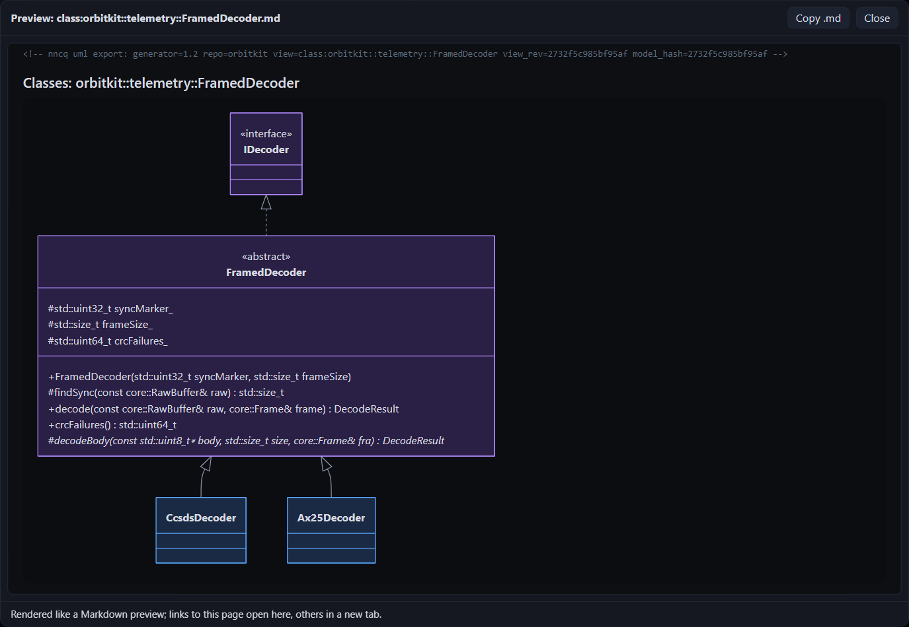</a><br><sub><b>Preview .md</b>: the Markdown export rendered like an editor preview, Mermaid included. <i>Generate .md</i> copies it; <i>Open in VS Code</i> writes it under <code>cache/exports/</code> and opens it.</sub></td></tr>
</table>

---

## Exports: Markdown, Mermaid, ASCII

`uml_view(format=markdown)`, **Generate .md** and **Preview .md** produce a pure Mermaid block (every node a link to its dashboard page) plus a list of the elements, with view and element revisions in the links: a page opened from an outdated export says so. Agent-made items end with a provenance footer. Below, two exports from the demo, unedited (the links point at a local dashboard, so they only work on a machine running nncq; full files in [demo/docs](demo/docs)).

The default diagram for `main` (`uml_view(subject="main", path="apps/groundd/main.cpp", depth=2)`):

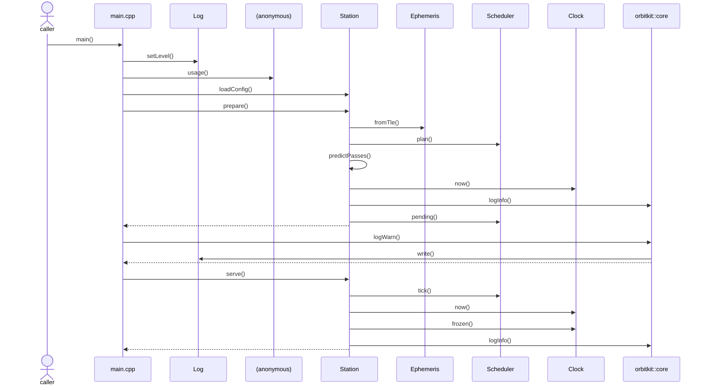

The agent-authored composition `ground-segment` (`uml_view(key="composition:ground-segment", format="markdown")`):

```mermaid
flowchart LR
  subgraph n_frame_ground_segment["«composition» Ground segment"]
    n_sat["«block»<br/>Satellite"]
    n_flow[\"«diagram»<br/>How a frame becomes packets"/]
    n_mcc(["Mission control"])
    n_archive["«block»<br/>Pass archive (.okp)"]
    subgraph n_g_station["Station computer (C++)"]
      n_link["orbit_link"]
      n_sched["orbit_sched"]
      n_tlm["orbit_telemetry"]
      n_app["groundd"]
    end
    subgraph n_g_offline["Offline (Python)"]
      n_tools["orbitkit-tools"]
    end
  end
  n_sat ==>|"flows-to UHF downlink"| n_link
  n_link ==>|"flows-to raw frames"| n_tlm
  n_sched -.->|"uses points, retunes"| n_link
  n_sched -.->|"uses runs each tick"| n_tlm
  n_app -.->|"uses"| n_sched
  n_tlm ==>|"flows-to UDP packets"| n_mcc
  n_tlm ==>|"flows-to FileSink"| n_archive
  n_tools -.->|"uses re-decodes, reports"| n_archive
  note_0>"From the satellite's downlink to mission control and the pass archive"]
  classDef k_class fill:#1b2a44,stroke:#5aa9ff,color:#d7dae0
  classDef k_interface fill:#2a1f44,stroke:#b28cff,color:#d7dae0
  classDef k_enum fill:#3a2d10,stroke:#e5a50a,color:#d7dae0
  classDef k_struct fill:#13332e,stroke:#3cc6b0,color:#d7dae0
  classDef k_function fill:#14301f,stroke:#4cc38a,color:#d7dae0
  classDef k_instance fill:#13332e,stroke:#5fd4c0,color:#d7dae0
  classDef k_component fill:#1e2633,stroke:#8fa3bf,color:#d7dae0
  classDef k_port fill:#1e2633,stroke:#8fa3bf,color:#d7dae0
  classDef k_package fill:#262033,stroke:#a58bd6,color:#d7dae0
  classDef k_config fill:#2d2a18,stroke:#c9b458,color:#d7dae0
  classDef k_release fill:#14301f,stroke:#4cc38a,color:#d7dae0
  classDef k_debug fill:#3a2d08,stroke:#e5a50a,color:#d7dae0
  classDef k_external fill:#17191d,stroke:#5a6375,color:#d7dae0
  classDef k_module fill:#232a33,stroke:#7f8ea3,color:#d7dae0
  classDef k_view fill:#1d2a44,stroke:#5aa9ff,color:#d7dae0
  classDef k_composition fill:#33203a,stroke:#d68be6,color:#d7dae0
  classDef k_note fill:#2b2a14,stroke:#8a7f3c,color:#d7dae0
  classDef k_block fill:#262b36,stroke:#8b95a7,color:#d7dae0
  classDef k_ext fill:#15171b,stroke:#4a5160,color:#8b95a7,stroke-dasharray:3 3
  classDef provided fill:#12351f,stroke:#4cc38a,color:#d7dae0
  classDef required fill:#3a2d08,stroke:#e5a50a,color:#d7dae0
  classDef bespoke stroke-dasharray:4 3
  classDef stale fill:#3a2d08,stroke:#e5a50a,stroke-width:2px,stroke-dasharray:6 3
  classDef root stroke-width:3px
  style n_frame_ground_segment fill:#5aa9ff0d,stroke:#5aa9ff66,color:#9aa3b0
  class n_sat bespoke
  class n_sat k_block
  class n_flow k_view
  class n_mcc bespoke
  class n_mcc k_block
  class n_archive bespoke
  class n_archive k_block
  style n_g_station fill:#ffffff09,stroke:#3d4658,color:#9aa3b0
  class n_link k_component
  class n_sched k_component
  class n_tlm k_component
  class n_app k_component
  style n_g_offline fill:#ffffff09,stroke:#3d4658,color:#9aa3b0
  class n_tools k_component
  click n_link href "http://127.0.0.1:8765/views#/uml/component/comp%3Aorbit_link?view=composition%3Aground-segment&v=df0618a266dd0ffb&h=5d19e86afa&repo=orbitkit" _blank
  click n_sched href "http://127.0.0.1:8765/views#/uml/component/comp%3Aorbit_sched?view=composition%3Aground-segment&v=df0618a266dd0ffb&h=3bb688e308&repo=orbitkit" _blank
  click n_tlm href "http://127.0.0.1:8765/views#/uml/component/comp%3Aorbit_telemetry?view=composition%3Aground-segment&v=df0618a266dd0ffb&h=2fec34738d&repo=orbitkit" _blank
  click n_app href "http://127.0.0.1:8765/views#/uml/component/comp%3Agroundd?view=composition%3Aground-segment&v=df0618a266dd0ffb&h=9c3c4971ff&repo=orbitkit" _blank
  click n_tools href "http://127.0.0.1:8765/views#/uml/component/comp%3Aorbitkit-tools?view=composition%3Aground-segment&v=df0618a266dd0ffb&h=47dd07a05c&repo=orbitkit" _blank
  click n_flow href "http://127.0.0.1:8765/views#/uml/view/view%3Adownlink-path?view=composition%3Aground-segment&v=df0618a266dd0ffb&h=f7367232c6&repo=orbitkit" _blank
%% made via mcp · copilot-cli:claude-opus-5.5
```

ASCII refuses compositions and embedded diagrams (it points to markdown instead) and caps big views with `+N more`; `nncq uml view KIND [SUBJECT] --format ascii|markdown|mermaid|json [-o file]` does the same from the command line.

---

## The UML / SysML model

Diagrams are queries over the same index, so they exist for any parsed code without a build.

- **Model.** With `NNCQ_UML=true` (default; asked by `nncq init`) the parse also records, per definition: visibility, modifiers (static, virtual, pure, override, const, ...), field / return / parameter types, template parameters, stereotypes (interface, abstract, singleton, dataclass) and exact column spans; member fields and in-class declarations; nested types; edges `composes` / `aggregates` / `associates` (value or `unique_ptr`, `shared_ptr`, pointer or reference), `depends` (signatures), `instantiates` (`new`, `make_unique`, locals, Python `Foo()`), imports, and the receiver of every call. A repo-level pass turns build files into components: CMake `add_library` / `add_executable` with their sources, include folders, link dependencies, options, configurations, toolchains and presets; Python packages and console scripts; folders as a fallback. Includes and imports are resolved to files. Off: `nncq uml init`, the `uml_build` tool or the dashboard button builds it later (one CPU re-parse; vectors are kept).
- **Generated views** (origin `auto`) are stored on first request and reused; **default diagrams** are made on demand for whatever you pick, and **file compositions** (`composition:file:<path>`) gather everything about a file.
- **Authored views and compositions** (origin `agent` / `user`, via `uml_upsert`, schema from `uml_protocol`). A view references generated elements by stable id and may add labelled bespoke nodes. A composition is a model element, not a diagram: members (generated elements, compositions, views, bespoke parts), typed connectors, groups. Either may reference the other; cycles are rejected. **Provenance:** the MCP client and the model id the agent passes are recorded; the dashboard shows an `mcp-agent` badge with the details, exports a footer.
- **CLI:** `nncq uml init | view KIND [SUBJECT] | list | show KEY | find NAME | upsert FILE | delete KEY | protocol`.

## Never stale: staleness and sync propagation

- **Deltas, not rebuilds.** The watcher re-indexes on save; `nncq update` after a sync re-parses only files whose content changed (SHA-1), and unchanged chunks keep their vectors. The graph is stored per file and resolved by name at query time, so a changed header does not re-process the files that include it.
- **Diagrams follow.** A changed or removed file marks only the views and compositions that depend on it. Generated views regenerate on next access (parts first for file compositions), with a report of what was added or removed. Authored ones get a per-member staleness report (changed, missing, moved, with the new location) and keep their members until the agent or user repairs them; the list shows a `stale` badge. Deleting an item flags everything that referenced it. Cached answers and renders are dropped with them.
- **Answers check the disk.** A result whose cited files changed since they were indexed carries a `divergent` field, and those files are re-indexed in the background right away.
- **Degradation is explicit.** When part of the index is catching up (a sync in progress, new code not embedded yet), responses carry `index_state`: what is degraded, where, since when, and what still works. Healthy responses carry nothing extra.

---

## The symbol graph: "how does it know that without a build?"

Usually, "who calls this", "what derives from this" or "who includes this header" needs an IDE that has **built** the project: clangd with `compile_commands.json`, IntelliSense with the right configuration, or a SCIP indexer running the compiler front-end. For a large C++ codebase that means generated code, millions of lines and hours of indexing. nncq gets a useful graph **without compiling anything**, using [tree-sitter](https://tree-sitter.github.io/):

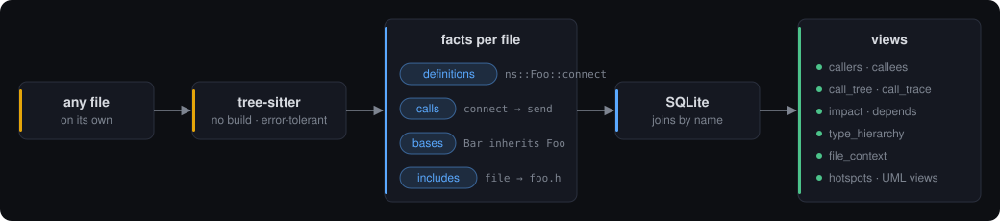

1. **Parse every file on its own.** tree-sitter is an incremental, error-tolerant parser, the one editors use for syntax highlighting. It needs no headers, macros, include paths or compiler flags; broken code still parses. For C, C++, HLSL and C#, the parser sees one branch of each `#if`/`#elif`/`#else`, as ctags does; definitions and calls in the other branches come from a second parse.
2. **Walk the tree once and record facts:** definitions with qualified names, parents, spans and signatures; calls from the enclosing definition to the callee's name and receiver; bases; includes; and the UML facts above.
3. **Join by name in SQLite.** "Callers of X" is an indexed lookup on the callee name; call trees, call paths, impact and dependency graphs are breadth-first walks over those joins.
4. **Chunk on the same tree.** Search chunks are cut at the same definition boundaries, so every search hit is already a graph node.

Parsing runs at about 500 files/s per CPU core. **The trade-off is honest:** links are by *name*, not resolved type. A call to `update()` matches every definition named `update`; nncq says when a name is ambiguous and ranks callers in the same class, or whose code mentions the class, first. For the questions you ask while reading code, name-level precision is usually enough, and it is available on every language and branch the moment the files are on disk.

### Compared with a grep or search skill

- **Concepts versus strings.** "Where do we throttle streaming when memory is low" matches nothing literally; embeddings and the reranker find it (full mode). BM25 still catches exact identifiers, and the two are fused.
- **Ranking and units of meaning.** Grep returns every matching line in file order; here a hit is the whole enclosing function, labelled with its class, and the best ten come first.
- **Structure.** Grep can't tell which method a call is in, what a class derives from or what depends on a header; the graph answers from one index lookup.
- **Data ↔ code.** Finding which of 390k data files use a type costs a ripgrep pass of tens of seconds each time; the profile-driven cross-reference answers in milliseconds.

`grep_code` is still included, because for an exact string grep is the right tool.

---

## Design

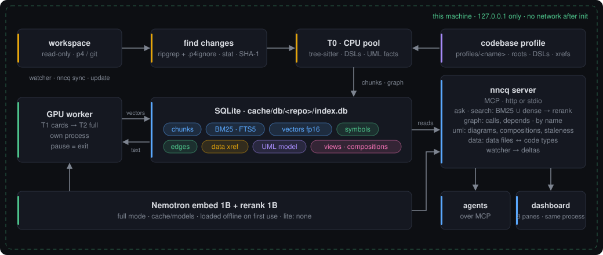

- **Chunking** (`chunker.py`): definitions become chunks; a class too big for one chunk is split into a header chunk plus one per member; code between definitions becomes gap chunks; very long functions are split into overlapping windows. Profile-declared definition languages use a brace-block chunker.
- **FTS:** identifiers are also indexed as sub-words, so `crc` matches `crcFailures_` and `Crc::check`. The symbol column is weighted above the body.
- **Search:** BM25 top 100 and dense top 100 merged by reciprocal-rank fusion; the top 40 go through the cross-encoder. Without vectors it falls back to lexical search and says so.
- **Data files** (`datarefs.py`, from a profile's `[[xref]]` rules) are not chunked or embedded: one ripgrep pass per rule records the instance types per file and the file→file references; code↔data joins go through type names.
- **UML** (`uml/`): `extract.py` (facts during the parse), `buildinfo.py` (CMake, presets, Python packaging, without running anything), `model.py` (components, file dependencies), `views.py` (generators), `catalog.py` (stored views, compositions, staleness, provenance, exports), `render_mermaid.py` / `render_ascii.py`, `web.py` (the Model explorer).
- **Storage layout:**
  ```
  init.ps1, pyproject.toml   repo root (launch + packaging only)
  src/nncq/                  all code (src/nncq/uml: the model)
  profiles/_template         the documented sample profile (others: git-ignored)
  profiles/archive/          exported profiles (contents git-ignored)
  demo/                      the bundled demo, a self-contained home: demo.cmd / demo.sh, orbitkit/ (code),
                             profiles/, docs/ (exports), .env, cache/ (its index; git-ignored)
  tools/                     screenshot and banner scripts
  docs/                      design notes, images
  .venv/  .env  cache/       python env, your settings, models / parsers / indexes / logs (git-ignored)
  cache/db/<repo>/index.db   one index per workspace (a home: profiles/ + cache/db + cache/logs + .env;
                             default the nncq folder, `nncq --home <dir>` for another)
  ```

### Why each tool is used

| Tool | Why |
|---|---|
| **NVIDIA Nemotron embed + rerank 1B (v2)** (full mode) | Strong on code and long passages. The embedder is Matryoshka-trained (truncated to `NNCQ_EMBED_DIM`) and asymmetric; the reranker is a cross-encoder, which is where most of the precision comes from. Pinned revisions, open weights |
| **torch (CUDA) + transformers + sentence-transformers** (full mode) | Runs both models in-process: no model server to install or keep running |
| **SQLite (FTS5)** | One file per workspace: chunks, BM25 index, vectors, symbols, edges, the UML model, views and the data cross-reference. No database server, safe concurrent reads (WAL) |
| **numpy** | Brute-force cosine over in-memory vectors: exact and fast enough for a few million chunks |
| **tree-sitter + language pack** | Fast, error-tolerant parsers for 20+ languages: chunk boundaries, symbols, calls and UML facts without compiling |
| **ripgrep** | Lists 1M+ files in seconds, honours `.gitignore` / `.p4ignore`; streams the data-file scan and backs `grep_code`. Installed into the venv from pip |
| **Mermaid** (pinned, vendored by `init`) | Renders the diagrams in the dashboard; the same text goes into Markdown exports that GitHub and VS Code render |
| **watchdog** | File-change events for automatic delta re-indexing |
| **mcp + uvicorn** | The standard MCP server (streamable HTTP and stdio) |

**Not used, and why:** Milvus / Qdrant / Docker (an extra always-on service; SQLite plus numpy covers this scale); Ollama (does not serve these models, and would be another service); LSP / SCIP indexers (need per-language servers and full builds; tree-sitter gives a name-based graph without building).

### GPU use during indexing: on demand, interruptible


- **Tiers.** T0 (CPU): chunks, BM25, symbols, graph, model: searchable within minutes. T1 (GPU): short "card" vectors. T2 (GPU): full-chunk vectors. Search uses whatever tier each chunk has reached; recently changed files go first. Lite mode stops at T0.
- **Pause and resume.** `nncq pause` makes the worker finish its batch and **exit**, so VRAM is fully released (an idle CUDA process still holds VRAM); `nncq resume` continues. Progress is saved per batch. The dashboard has a visible **❚❚ pause** button.
- **Polite mode.** `NNCQ_BG_WHEN=idle` embeds only after `NNCQ_IDLE_MINUTES` without input; `NNCQ_GPU_MIN_FREE_MB` skips starting while the GPU is busy; the worker releases the GPU for `NNCQ_GPU_BREAK_MS` every `NNCQ_GPU_BREAK_EVERY_S`, leaves `NNCQ_GPU_RESERVE_MB` for other apps, and yields to queries.

### Design choices and why

#### Ask, not search

An agent does not need ten code blocks; it needs to know **which few places matter and why**, then read only those. `ask` answers with a map an LLM can collate into a reply, generated deterministically from the index: **no LLM** runs on the server, so it is fast, reproducible and never paraphrases the code wrongly.


- **How the question was read:** the words used (with stems and identifier parts), how common each is in the code, what was ignored, whether meaning search was used. "`seat`: 0.00% of code" says the codebase uses another word.
- **The code's own words:** identifiers that recur across the top candidates, to ask with next.
- **What came back:** areas, kinds, which channel found the hits, and a **strength verdict** from the reranker (lite: `unrated`). A weak result says so instead of presenting noise as an answer.
- **Facts instead of code, one line each:** signature and doc comment, calls that matter, callers with counts, bases and members, the 1-2 best-matching lines; then **links between hits** (A calls B, derives from, same class), which is usually the actual answer to "how does X work".

#### Short first, drill down on demand

- `ask` returns about 5-9 KB for 8 hits; `expand(refs)` returns exact current code for the chosen hits only, or structure (`what=context|callers|callees|outline`).
- **No answer is cut off by the client.** Answers above `NNCQ_MAX_RESPONSE_KB` are trimmed at their largest list; `paged` names the field and the `more(cursor)` call for the rest.
- **Repeats are free.** Read-only answers are cached for `NNCQ_CACHE_MINUTES` or until the index changes, for agents and the dashboard alike.

#### The MCP client owns the lifetime

Over stdio, nncq runs **inside** the agent's MCP process and exits with it, stopping its GPU worker. Nothing is left running after you close the agent, and there is no service to install. The first copy binds the port and owns indexing; other copies only answer queries and take over if the owner goes away. `nncq start` / `nncq serve` is the opt-in standalone mode.

---

## Local only and air-gapped

- The network is used **only during `init`**: pip packages, a one-time download of the pinned model revisions (full mode) and one pinned, sha256-verified Mermaid build. After that the Hugging Face stack is forced offline and models load from the repo folder.
- No cloud APIs, no telemetry, no external services. The server binds to `127.0.0.1`; a non-loopback bind is refused unless `NNCQ_TOKEN` is set (or `NNCQ_PUBLIC=1`, the read-only mode the hosted demo uses). File actions in the dashboard (reveal, open, edit, VCS) work on a loopback host only, on an explicit click.
- For a machine with no internet, copy the models with `init.ps1 -SeedModels <hub dir>`; pip still needs a wheel cache or mirror.
- Everything lives inside the clone (`.venv/`, `cache/`, `.env`): deleting the folder uninstalls it. No shared server, on purpose: nncq adds no new place your code or index goes.

## Requirements and cost

- **Lite:** any Windows machine with Python 3.11+, ~150 MB.
- **Full:** NVIDIA GPU with CUDA 12.8 support; the embedder and reranker are ~1B parameters each, about 2.5 GB VRAM each in bf16. Developed on a 16 GB card; 8 GB should work with a smaller `NNCQ_GPU_BATCH_TOKENS`.
- **Disk (full):** `.venv` 4.6 GB (4.1 GB of it CUDA torch), `cache/models` 9.2 GB, `cache/tools` 2.7 GB (mostly a deletable pip cache). Index: vectors 2 KB per chunk (about 2 GB per million chunks); data cross-reference about 1 KB per data file.
- **Time (measured on a large C++ workspace):** T0 parsing about 300 files/s with the process pool (4,199 files, 42k chunks in 12-15 s); embedding about 3 min of cards then about 20 min of full vectors per 42k chunks; a query with reranking about 1 s; graph views 0-220 ms on 43k symbols and 260k edges. The demo indexes in under a second.

## Configuration (`.env`)

| Variable | Default | Meaning |
|---|---|---|
| `NNCQ_HOST` / `NNCQ_PORT` / `NNCQ_TOKEN` | `127.0.0.1` / `8765` / | bind address and port; token required for non-loopback |
| `NNCQ_PUBLIC` | `false` | read-only public demo: no token needed off loopback; indexing, model writes, pause / resume and file actions are off |
| `NNCQ_START` | | dashboard hash a bare URL opens on (the demo sets its tour start) |
| `NNCQ_MODE` | `full` | `lite`: keyword + graph + model only, no torch, models or GPU |
| `NNCQ_UML` | `true` | build the UML / SysML model at index time (else on demand: `nncq uml init`) |
| `NNCQ_DATA` | `true` | maintain the data cross-reference (profiles with `[[xref]]` rules) |
| `NNCQ_WATCH` | `true` | re-index on file save |
| `NNCQ_WORKSPACE_<NAME>` | | workspace root for profile `<name>` on this machine (overrides the profile's candidates) |
| `NNCQ_DEVICE` / `NNCQ_DTYPE` | `auto` / `bf16` | `cuda`, `cpu` or `auto`; `fp32` doubles VRAM for no practical gain |
| `NNCQ_EMBED_DIM` / `NNCQ_EMBED_TIER` | `1024` / `2` | vector size (up to 2048); `0` no vectors, `1` cards only, `2` cards then full chunks |
| `NNCQ_BG_WHEN` / `NNCQ_IDLE_MINUTES` | `always` / `5` | embed only when idle |
| `NNCQ_GPU_MIN_FREE_MB` / `NNCQ_GPU_BATCH_TOKENS` | `0` / `32768` | don't start below this much free VRAM; GPU batch size |
| `NNCQ_GPU_BREAK_EVERY_S` / `NNCQ_GPU_BREAK_MS` / `NNCQ_GPU_RESERVE_MB` | `5` / `100` / `1024` | give the GPU up this often for this long; VRAM left for other apps |
| `NNCQ_RERANK` / `NNCQ_RERANK_CANDIDATES` | `true` / `40` | cross-encoder reranking |
| `NNCQ_INDEX_PROCS` | half the cores (max 8) | T0 parser processes |
| `NNCQ_TEXT_LANGS` | `markdown,cmake,make,dockerfile,proto,batch` | non-code formats to index |
| `NNCQ_EXTRA_EXTENSIONS` / `NNCQ_IGNORE` | | e.g. `.foo,.bar=cpp`; extra ignore globs |
| `NNCQ_MAX_RESPONSE_KB` / `NNCQ_CACHE_MINUTES` | `16` / `15` | trim and page larger answers; answer cache lifetime (0 = off) |

Every option, with comments: [`.env.example`](.env.example).

## Tests and tools

```powershell
.venv\Scripts\python -m pytest -q tst      # chunking, deltas, graph, profiles, UML model / views / staleness (no GPU)
.venv\Scripts\nncq doctor                  # installation check
```

The README visuals are reproducible from the demo, against a running server (`demo\demo.cmd`):

```powershell
.venv\Scripts\python demo\seed_model.py                                    # diagrams + agent-made items, exports in demo\cache\seed-out
.venv\Scripts\python tools\screens.py --url http://127.0.0.1:8766          # headless Edge / Chrome over DevTools -> docs\img\*.png, sync.gif
.venv\Scripts\python tools\banner.py                                       # docs\img\banner.svg from docs\img\hero.png
```

`screens.py` needs only the standard library (Pillow, when installed, shrinks the PNGs; `banner.py` needs it). Headless browsers do not paint native tooltips, so `screens.py` draws the code view's and the badge's tooltip text itself.

## Limitations

- **The graph is name-based, not type-resolved.** See [the trade-off](#the-symbol-graph-how-does-it-know-that-without-a-build). Sequence diagrams follow a call through an interface to the interface, not to its implementations.
- **Static only.** Jobs, callbacks, virtual dispatch and script bindings break traces; nncq says where a trail goes cold instead of inventing the hop.
- **Data ↔ code goes through type names**, not runtime paths.
- **One machine per person, by design.** No shared or LAN server; coworkers without a GPU use lite mode.
- **Windows first.** Nothing in the core is Windows-specific, but there is no `init.sh` yet.

## Roadmap

- **Next:** changelist stamping and range deltas, constructor and callback edges in the call graph, override links, Linux `init.sh` ([docs/ideas.md](docs/ideas.md)).
- **Editor plugins** calling the same local server: symbol card, call tree, impact and diagrams for the symbol under the caret; "what data uses this" for profile data rules.
- **Round-trip UML:** diagram edits turned into source patches (the model keeps the spans and declaration text it needs).
