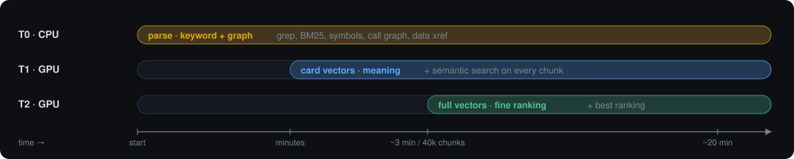
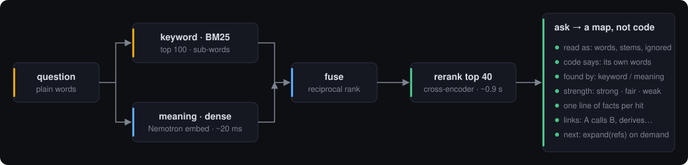

<a href="docs/img/dashboard.png" title="Open the full dashboard screenshot"></a>

# no-net-code-query (nncq)

**Ask questions, don't search the code.**

nncq is not another search tool. Search gives you lines that match a string. nncq gives your coding agent the structure of the codebase: whole functions and classes, who calls what, how execution gets from A to B, what breaks if X changes, and, for engine, which data uses which code. It answers in plain words, across millions of lines, with no build, no IDE index and nothing leaving your machine.

### Two ways to use it

**1. Supercharge your coding agent (the main use).** Add nncq to Copilot CLI, Claude Code or Visual Studio over MCP (`nncq agents` does it for you). Your agent stops grepping and guessing and starts tracing:

- `ask` a question, get a short map of the few places that matter and how they connect, not ten code dumps
- `called_by` / `calls` / `call_tree`: callers and callees with `file:line`, N levels deep
- `call_trace`: debugger-style stacks showing how execution reaches a function
- `impact`: the blast radius before you change a signature
- `data_for_code` / `code_for_data`: engine code <-> `.xdata` assets in milliseconds

Every answer is sized for the agent's context (a few KB), so it can ask many questions and still have room to think. You ask the agent; the agent investigates and hands you one digest.

**2. A web view for you (optional).** The same index in your browser at `http://127.0.0.1:8765/`: ask box, answer maps, a symbol explorer with call trees both ways, and index/GPU status. It starts only when you open it.

Runs on any machine in the lite profile (keyword search + graph, no GPU), or with an NVIDIA GPU for meaning-based search and reranking.

> **Status: phase 1 working.** Indexing (tree-sitter + engine DSLs, `.xdata` cross-reference), the GPU embedding worker, hybrid search, the graph views, the MCP server (24 tools) and the CLI are in and tested on a 4,200-file slice of the sample workspace. Not yet: Linux `init.sh`, editor plugins.

## Contents

| Use it | How it works | Run it |
|---|---|---|
| [What it gives an agent](#what-it-gives-an-agent) | [Design](#design) | [Quick start (Windows)](#quick-start-windows) |
| &nbsp;&nbsp;[Search and the AST together](#search-and-the-ast-work-together) | [Why each tool is used](#why-each-tool-is-used) | [Configuration (`.env`)](#configuration-env) |
| &nbsp;&nbsp;[Symbol graph without a build](#the-symbol-graph-how-does-it-know-that-without-a-build) | [GPU use during indexing](#gpu-use-during-indexing-on-demand-interruptible) | [Requirements and cost](#requirements-and-cost) |
| &nbsp;&nbsp;[Graph tools](#graph-tools) | [Design choices and why](#design-choices-and-why) | [Local only and air-gapped](#local-only-and-air-gapped) |
| &nbsp;&nbsp;[Compared with grep](#compared-with-a-grep-or-search-skill) | &nbsp;&nbsp;[Ask, not search](#ask-not-search) | [Tests](#tests) |
| | &nbsp;&nbsp;[Short first, drill down](#short-first-drill-down-on-demand) | [Limitations](#limitations) |
| | &nbsp;&nbsp;[MCP client owns the lifetime](#the-mcp-client-owns-the-lifetime) | [Roadmap](#roadmap) |
| | &nbsp;&nbsp;[Pausing frees the GPU](#pausing-frees-the-gpu-completely) | |
| | &nbsp;&nbsp;[The web page](#the-web-page-one-screen-status--ask--symbols) | |

Also: [Profiles: full and lite](#profiles-full-and-lite) | [Agent setup](#agent-setup-nncq-agents) | [Why not just Copilot + Visual Assist?](docs/why-nncq.md)

---

## What it gives an agent

| MCP tool | Answers |
|---|---|
| `ask` | **Start here.** A question in plain words returns a short generated map, not code: how the question was read, what the hits cover, one line of facts per hit, and how the hits call each other. Each hit has a ref to dig into. [Why](#ask-not-search) |
| `expand` | Dig into `ask` refs (or `path:start-end`, which is resolved to its enclosing symbol): exact code, symbol card, callers, callees or file outline |
| `more` | The rest of an answer that was trimmed to fit (`paged` gives the cursor) |
| `search_code` | Raw hybrid search (keywords plus meaning plus reranker). Returns whole functions or classes as code blocks |
| `grep_code` | exact text or regex matches (ripgrep, honours `.p4ignore`) |
| `find_symbol` | where a class, function or method is defined |
| `file_outline` | the symbols in a file, with line ranges, without reading the file |
| `find_references` | callers, subclasses, and text mentions of a name |
| `symbol_context`, `calls`, `called_by`, `call_tree`, `call_trace`, `impact`, `type_hierarchy`, `file_context`, `hotspots` | the symbol graph views, [see below](#graph-tools) |
| `read_code` | an exact line range from disk |
| `data_for_code` | engine: which data types / assets use this code type |
| `code_for_data` | engine: which code defines or implements the types this asset uses |
| `asset_info`, `top_assets` | engine: what an asset contains, which assets are referenced most |
| `index_status`, `update_index` | freshness, embedding progress, delta re-index |

### Search and the AST work together

Search results are not just matching text. Every chunk is cut at a function or class boundary and carries its **path, line range, symbol, kind and parent**. Every symbol is also a node in the graph, so an agent can chain tools without reading whole files:

1. `search_code("how are emitter graphs spawned")` returns `EmitterGraphEntity::onCreate` in `EmitterGraphEntity.cpp:120-188`, kind `method`, parent `EmitterGraphEntity`.
2. `call_tree("onCreate", in)` shows who triggers it. `file_outline` shows the rest of the class.
3. `data_for_code("EmitterGraphEntity")` returns `Effect.EmitterGraphEntityData`, used by 3,400 `.xdata` assets, with the top ones listed.
4. `asset_info("EBP_TOY_Stopper_Damaged")` → which types it instantiates and what references it. `code_for_data` leads back to the `.ddf` and C++.

Each step returns a few hundred tokens of structured answer instead of thousands of tokens of raw file text.

### The symbol graph: "how does it know that without a build?"

Usually, to get "who calls this", "what derives from this" or "who includes this header" you need an IDE that has **built** the project: clangd with `compile_commands.json`, IntelliSense with the right configuration, or a SCIP indexer that runs the compiler front-end. For engine that means generated code, millions of lines, and hours of indexing.

nncq gets a useful graph **without compiling anything**, using [tree-sitter](https://tree-sitter.github.io/):


1. **Parse every file on its own.** tree-sitter is an incremental, error-tolerant parser, the same one editors use for syntax highlighting. It turns each file into a concrete syntax tree in milliseconds. It needs no headers, macros, include paths or compiler flags. Broken or half-written code still parses, with the bad region marked. For C, C++, HLSL and C#, the parser sees one branch of each `#if`/`#elif`/`#else` (the first, or the `#else` of `#if 0`), as ctags does: two alternative function headers in `#if` branches would otherwise turn a whole file into one error node. Definitions and calls in the other branches are picked up from a second parse and attached to the enclosing definition.
2. **Walk the tree once and record facts:**
   - *definitions*: class, struct, enum, function, method, namespace, with qualified name (`app::EmitterGraphEntity::onCreate`), parent, line span and signature
   - *calls*: from the enclosing definition to the callee's name (`onCreate → spawnEmitter`)
   - *bases*: `class Bar : public Foo` gives `Bar inherits Foo` (C++, C#, Python, Java, TS/JS, Kotlin, Swift, PHP, Ruby, and engine DDF)
   - *includes*: `#include "Engine/Core/Foo.h"` gives `file includes foo.h`
3. **Join by name in SQLite.** "Callers of X" is an indexed lookup on the callee name. "Derived from X" is the same on base names. Call trees, call paths and impact analysis are breadth-first walks over those joins.
4. **Chunk on the same tree.** Search chunks are cut at the same definition boundaries, so every search hit is already a graph node. That's why search and navigation compose.

The parsers are a few MB each, cached in `cache/tools/tree-sitter`. Parsing runs at about 500 files/s per CPU core, so a full engine tree takes minutes, and a delta after `p4 sync` takes seconds.

**The trade-off is honest:** links are by *name*, not resolved type. A call to `update()` matches every definition named `update`. nncq says when a name is ambiguous and ranks callers that are in the same class, or whose code mentions the class, first. Qualified names and paths narrow it down. For the questions you ask while reading code ("roughly who uses this", "how are A and B related", "what breaks if I change this"), name-level precision is usually enough. It is available on every language and branch the moment the files are on disk.

#### Graph tools

| Tool | What you get |
|---|---|
| `symbol_context` | One-call card for a symbol. For a type: definition(s), bases and base chains, derived types, members, engine data types that use it. For a function: callers (ranked), callees (resolved to definitions when unique), overrides up and down the hierarchy. Plus how many files mention it and whether the name is ambiguous |
| `calls` | Flat "Calls From" list: everything a function calls, in source order, each resolved to its definition when the name is unique (exact spelling, same language family) or defined in the caller's own class (`same class; N defs`). A call counts as the class's own when it is plain, through `this`, or through a receiver named after the class (`gameRenderer->`); `m_pool->endFrame()` stays ambiguous. Macros and plumbing are folded into one closing line |
| `called_by` | Flat "Calls To" list: every caller with file:line. When several functions share the name, rows are ranked same class > code mentions the class > name only, and callers whose own class defines the same name are dropped (they call their own). `caller_path` keeps callers in matching files |
| `call_tree` | Callers (`in`) or callees (`out`) as an indented tree, N levels deep, cycle-safe. Callers are ranked like `called_by` at every level. Callees skip macros and plumbing (names called from more than 1,500 places, counted in the note), and names with several definitions are listed but not expanded |
| `call_trace` | "How does execution get here?" as debugger-style pseudo stacks (innermost frame first, file:line per frame), walked back to entry points (functions nothing calls). Given two functions, it shows how they relate: A reaches B, B reaches A, or a nearest common caller of both. Routes whose links stay inside the callee's class or go through unique names are listed first. A link that matched by name alone is tagged `[calls X: N defs]`. A trail that goes cold (a function only called by same-named functions of other classes, typical for jobs, callbacks and virtuals) ends with a note saying so |

All caller and callee lookups stay inside the definition's language family (C/C++ together, JS/TS together), so a C++ `render` is not "called" from Python. Test and mock code (test folders and files, `TEST_F`-style callers) is tagged `(test)` and listed after production code, and `call_trace` lists stacks through tests last.
| `impact` | Transitive callers of X, summarised by folder and file: the blast radius before you change a signature |
| `type_hierarchy` | Base chain(s) up and the derived tree down |
| `file_context` | Outline, `#include`s, who includes this file, and which files it calls into or is called from |
| `hotspots` | Static top-N tables per folder: most-called functions, most-derived bases, biggest fan-out, most-included headers, largest functions, uncalled functions (dead-code candidates) |

### Compared with a grep or search skill

A grep skill is good when you know the exact string. It falls short when you don't:

- **Concepts versus strings.** "Where do we throttle streaming when memory is low" matches nothing literally. Embeddings and the reranker find it. BM25 still catches exact identifiers, and the two are fused so neither kind of query suffers.
- **Ranking.** Grep returns every match in file order. In a 1M-file workspace that is hundreds of hits, and the agent pays tokens to read them. Here a cross-encoder reranks the top 40 and the agent sees the best 10.
- **Units of meaning.** Grep returns a line. Here a hit is the whole enclosing function, labelled with its class.
- **Structure.** Grep can't tell you which method a call is in, what a class derives from, or what a file defines. The graph answers that from one index lookup.
- **Data↔code.** Finding which of 392k `.xdata` files use a type costs a 35-second ripgrep pass each time. The cross-reference answers it in milliseconds.
- **Precomputed.** Parsing and embedding happen once, plus small deltas. Queries are index lookups, not tree walks.

`grep_code` is still included, because for an exact string grep is the right tool.

---

## Local only and air-gapped

- The network is used **only during `init`**: pip packages and a one-time download of the pinned model revisions into `cache/models/hf`.
- After that, the Hugging Face stack is forced offline (`HF_HUB_OFFLINE=1`, telemetry off). Models load from the repo folder.
- There are no cloud APIs, no telemetry and no external services. The server binds to `127.0.0.1` only. A non-loopback bind is refused unless `NNCQ_TOKEN` is set.
- For a machine with no internet, copy the models from another checkout with `init.ps1 -SeedModels <hub dir>`. pip still needs a wheel cache or mirror.
- Everything lives inside the clone (`.venv/`, `cache/`, `.env`). Deleting the folder uninstalls it.
- No shared server, on purpose: nncq adds no new place your code or index goes, so there is no data-security question to answer before a coworker installs it.

## Requirements and cost

- **GPU:** NVIDIA with CUDA 12.8 support. Embedder and reranker are ~1B parameters each, about 2.5 GB VRAM each in bf16, plus working memory. Developed on an RTX 5080 (16 GB). An 8 GB card should work with a smaller `NNCQ_GPU_BATCH_TOKENS`. CPU-only works for queries but is too slow to embed a large codebase.
- **Disk:**

  | What | Size | Notes |
  |---|---|---|
  | `.venv` | 4.6 GB | 4.1 GB of it is CUDA torch |
  | `cache/models` | 9.2 GB | two Nemotron models as published (weights 2.3 GB each) |
  | `cache/tools` | 2.7 GB | pip cache and tree-sitter parsers. The pip cache can be deleted |
  | index | varies | engine data cross-reference: 420 MB for 390k `.xdata`. Vectors: 2 KB per chunk (1024-dim fp16), about 2 GB per million chunks |

- **RAM:** the server keeps vectors in memory (2 KB per chunk). Models load on first query and unload after `NNCQ_MODEL_IDLE_SECONDS`.
- **Time (measured on the sample workspace, RTX 5080):**
  - T0 parsing: about 300 files/s with the process pool (4,199 files, 42k chunks in 12–15 s, including a full re-parse).
  - Full `.xdata` cross-reference: 75–84 s for 388k files. Start-up catch-up (stat every `.xdata`, rescan changed): about 25 s.
  - Embedding: cards (T1) about 200–290 chunks/s, full chunks (T2) about 35–40 chunks/s. 42k chunks: about 3 min of cards (search is semantic from then on), then about 20 min of full vectors.
  - Queries: hybrid + rerank about 1 s (query embedding 20 ms, reranking 40 candidates about 0.9 s). The first query after start loads both models (about 10 s). Graph views: 0–220 ms on 43k symbols and 260k edges.

## GPU use during indexing: on demand, interruptible

Embedding keeps the GPU close to fully busy. It is built to stay out of your way:



- **Tiers.**
  - **T0 (CPU):** chunks, BM25, symbols and graph. Searchable within minutes.
  - **T1 (GPU):** short "card" vectors (path, symbol, signature), cheap and fast.
  - **T2 (GPU):** full-chunk vectors.

  Search uses whatever tier each chunk has reached. Recently changed files go first.
- **Pause and resume.** `nncq pause` makes the worker finish its current batch and **exit**, so VRAM is fully released (it runs as its own process). `nncq resume` picks up where it stopped. Progress is saved per batch, so Ctrl+C, a reboot or a crash loses at most one batch.
- **On demand.** `NNCQ_EMBED_TIER=0` disables background embedding. You can also run `nncq work` only when you choose.
- **Polite mode.** `NNCQ_BG_WHEN=idle` embeds only after `NNCQ_IDLE_MINUTES` without keyboard or mouse input. `NNCQ_GPU_MIN_FREE_MB` skips starting while the GPU is busy, e.g. a game or the editor. While embedding, the GPU is released for `NNCQ_GPU_BREAK_MS` (100 ms) every `NNCQ_GPU_BREAK_EVERY_S` (5 s), so Snipping Tool, the desktop and other CUDA apps are not starved.
- **Queries stay light, and come first.** A query is one short embedding plus reranking 40 chunks, about 1 s. While a search uses the GPU, the worker holds its next batch (batches are small, about 1 s), so searches stay fast during embedding. Without this, server and worker fighting over VRAM made reranking take 20–50 s.
- **VRAM is left for others.** Each nncq process is capped at total VRAM minus `NNCQ_GPU_RESERVE_MB` (1 GB). While the card has less than that free, for example because a game or the editor grew, GPU batches are split in halves instead of crowding the other app out. Running out of memory also halves the batch and retries; it never fails the job.

---

## Why each tool is used

| Tool | Why |
|---|---|
| **NVIDIA Nemotron embed + rerank 1B (v2)** | Strong on code and long passages. The embedder is Matryoshka-trained (2048 dims, truncated to `NNCQ_EMBED_DIM`) and asymmetric (separate query and document prompts). The reranker is a cross-encoder, which is where most of the precision comes from. Pinned revisions, open weights. |
| **torch (CUDA) + transformers + sentence-transformers** | Runs both models in-process. There's no model server to install or keep running. |
| **SQLite (FTS5)** | One file per workspace holds chunks, BM25 index, vectors, symbols, edges and the data cross-reference. No database server, safe concurrent reads (WAL), part of Python. |
| **numpy** | Brute-force cosine over in-memory vectors. Exact and fast enough for a few million chunks, with nothing extra to tune. |
| **tree-sitter + language pack** | Fast, error-tolerant parsers for 20+ languages. They provide AST chunk boundaries, symbols and call edges without compiling anything. |
| **ripgrep** | Lists 1M+ files in seconds and honours `.p4ignore`/`.gitignore`. Also streams the `.xdata` scan and backs `grep_code`. Installed into the venv from pip. |
| **watchdog** | File-change events for automatic delta re-indexing. |
| **mcp + uvicorn** | The standard MCP server (streamable HTTP and stdio), usable from Copilot CLI, VS Code, Claude Code and others. |

**Not used, and why:**
- **Milvus, Qdrant, Docker:** an extra always-on service. SQLite plus numpy covers this scale.
- **Ollama:** it does not serve the Nemotron models, and it would be another service.
- **LSP/SCIP indexers (clangd, Serena):** they need per-language servers and full builds. For engine C++ that means a working `compile_commands.json` for millions of lines. tree-sitter gives a **name-based** graph without building. The trade-off is that calls are matched by name, not by resolved type. See Limitations.

---

## Design


- **Chunking** (`chunker.py`):
  - Definitions become chunks. A class too big for one chunk is split into a header chunk plus one chunk per member.
  - Code between definitions becomes gap chunks. Very long functions are split into overlapping line windows.
  - engine `.ddf/.adf/.ser/.hubl` use a brace-block chunker. `.ddf` types are qualified by their `module` (`Entity.LayerData`), which is exactly how `.xdata` names them.
- **FTS:** identifiers are also indexed as sub-words, so `spawn` matches `SpawnEntityData` and `spawn_entity`. The symbol column is weighted above the body.
- **Search:**
  - BM25 top 100 and dense top 100 are merged by reciprocal-rank fusion.
  - The top 40 go through the cross-encoder.
  - If no vectors exist yet, it falls back to lexical search and says so.
- **Graph:**
  - Symbols cover each definition: qualified name, kind, parent, lines and signature.
  - Edges are `call` (enclosing symbol → callee name) and `inherits` (type → base).
  - Call hierarchy walks edges by name.
- **engine data** (`datarefs.py`):
  - `.xdata` files are *not* chunked or embedded. One ripgrep pass records the instance types per file and the asset→asset references.
  - Code↔data joins go through type names. `entity Foo` in DDF corresponds to data type `FooData`, and DDF `: Base` edges add subclasses.
  - Asset lookups use reversed-path keys, so any path suffix resolves.
- **Deltas: a sync never forces a rebuild.** Cost follows what changed, not the workspace size:
  - `nncq update` compares on-disk stats with the index. A file is re-parsed only when its SHA-1 changed, so a `p4 sync` that only touches mtimes is cheap.
  - `nncq sync [p4 args]` runs `p4 sync` and re-indexes exactly the files it reports, however many there are.
  - The server's watcher handles edits as you save.
  - The graph is stored per file and resolved by name at query time. A changed header does not re-process the files that include it, and calls between unchanged files stay correct.
  - Chunks whose text did not change keep their vectors, so editing one function in a 3,000-line file re-embeds one chunk. Only that edit loses semantic search until the background worker catches up; keyword and graph search see it immediately.
  - `.xdata` changes update the data cross-reference incrementally, in small transactions (about 700 files/s), so it stays queryable throughout.
  - `nncq index --fresh` rebuilds everything from scratch. It is never needed for correctness; run it overnight if you want a clean slate.
- **Graceful degradation:** tools never block on indexing. When something is stale, a response carries `index_state`: what is degraded, where (folders), since when, what still works, and whether the returned results fall in that area. Cases: a sync in progress or interrupted, changed code not embedded yet, and the semantic index still building. Healthy responses carry nothing extra.
- **Storage layout:**
  ```
  init.ps1, pyproject.toml   repo root (launch + packaging only)
  src/nncq/                  all code
  docs/                      design notes (docs/ideas.md: unbuilt ideas)
  .venv/                     python env            (git-ignored)
  .env                       your settings         (git-ignored, written by init)
  cache/models/hf/           model weights         (git-ignored)
  cache/tools/               pip, parsers, torch   (git-ignored)
  cache/db/<repo>/index.db   one index per workspace
  cache/logs/                server / worker logs
  ```

---

## Design choices and why

### Ask, not search

An agent does not need ten code blocks. It needs to know **which few places matter and why**, then read only those. Raw search answered "how does rendering get computed" with five unexplained blocks, 13 KB, and gave no sign that the match was weak. `ask` answers with a map an LLM can collate into a reply. The map is generated deterministically from the index: **no LLM** runs on the server, so it is fast and reproducible, and it never paraphrases the code wrongly.



- **How the question was read.** It shows:
  - the words it used, with stems (`rendering → render*`) and identifier parts;
  - how common each word is in the code, and how many hits contain it;
  - the words it ignored;
  - whether meaning search was used, and how much of the code has vectors yet.

  This makes a bad match explainable: "`seat`: 0.00% of code" says the codebase uses another word.
- **The code's own words.** Identifiers that recur across the top candidates, such as `ServerVehicleSpawnEntity` for "spawn player into vehicle", are what to ask with next.
- **What came back (portfolio).**
  - Areas (folders) and kinds (function, class, doc).
  - Which channel found the hits: keyword, meaning, or both.
  - Where each channel led on its own.
  - A **strength verdict** from the reranker: strong, fair or weak. A weak result says so and suggests a better question, instead of presenting noise as an answer.
- **Why each hit is there:** its keyword rank, meaning rank, rerank score and the matched words.
- **Facts instead of code, one line each:**
  - signature and doc comment (taken from the code, or from the comment above the declaration);
  - calls that matter (logging, macros and calls used everywhere are hidden and counted);
  - callers with call-site counts;
  - bases and members;
  - the 1–2 lines that best match.
- **Links between hits:** A calls B, A reaches B through one hop, members of the same class, derives from. This is usually the actual answer to "how does X work": the hits form a chain.
- **Next steps:** an `expand` call for the top refs, a `call_trace` for the best function, a narrower `path=`, or a re-ask in the code's words.

### Short first, drill down on demand

Context is the agent's scarcest resource, so every response is sized for it:

- `ask` returns about 5–9 KB for 8 hits. That is less than one large function, and enough to decide what to read.
- `expand(refs)` returns exact current code from disk for only the chosen hits, capped per hit, with a `read_code` follow-up for the rest. A ref to one window of a long function returns the whole function when it fits (160 lines), otherwise the window plus `before`/`more` calls for the rest. `what=context|callers|callees|outline` returns structure instead of code.
- Split chunks of one function are merged into one hit (the best-matching window, with `window: part of X 7265-7307; 3 windows matched`), and identical code at several paths is listed once (`also at`), so the hit budget is not spent on duplicates.
- **No answer is cut off by the client.** MCP clients spill or truncate long tool results (Copilot CLI writes anything above ~20 KB to a temp file the agent has to read back). Answers above `NNCQ_MAX_RESPONSE_KB` (16) are trimmed at their largest list or multi-line field; `paged` names the field, what is shown, and the `more(cursor=...)` call for the rest.
- **Repeats are free.** Every read-only answer is cached in the server for `NNCQ_CACHE_MINUTES` (15) or until the index changes, for agents and the dashboard alike. `ask` is cached without `k`: a cached 8-hit answer serves `k=5` instantly.
- Healthy responses carry nothing extra. `index_state` appears only when something is degraded.

### The MCP client owns the lifetime

Over stdio, nncq runs **inside** the agent's MCP process and exits with it. When stdin closes, it stops its GPU worker and exits. The worker also exits on its own if its parent disappears. Nothing is left running in the background after you close the agent, and there is no service to install or forget about. The first copy binds the port and owns indexing; other copies only answer queries and take over if the owner goes away. `nncq serve` is the opt-in standalone mode for several clients.

### Pausing frees the GPU completely

Pause makes the embedding worker finish its batch and **exit**, rather than idle, because an idle CUDA process still holds VRAM. Progress is saved per batch, so resuming loses nothing. While it runs, the worker:

- releases the GPU for 100 ms every 5 s, so screen capture and the desktop are not starved;
- leaves 1 GB of VRAM for other apps;
- yields to queries.

The page has a visible **❚❚ pause** button for when you need the card yourself.

### The web page: one screen, status → ask → symbols

<a href="docs/img/dashboard.png" title="Full screenshot"></a>

| Status and GPU | An answer: how it was read, then files |
|---|---|
| <a href="docs/img/status.png"></a> | <a href="docs/img/answer.png"></a> |
| **Symbol explorer: callers and callees** | **Viewer: facts, then code with matched lines** |
| <a href="docs/img/symbols.png"></a> | <a href="docs/img/viewer.png"></a> |

- **One page, no menus.**
  - **Left column:** status, the ask box, the symbol explorer and the console.
  - **Right half:** a viewer shared by search hits and the symbol view.

  Results never push the symbol view off screen, and the viewer has room for long lines and signatures that would otherwise be truncated.
- **Two roll-ups for an answer.**
  1. How the question was read, plus the portfolio.
  2. The list of files.

  Each is collapsible. Picking a file opens its hits (facts, then code with the matching lines highlighted) on the right. **×** or **Esc** returns search to its home state.
- **Visual emphasis over text:**
  - rings and bars for indexing progress and the GPU;
  - colour-coded stage lights;
  - a strength badge on each answer;
  - a stacked bar for which channel found the hits;
  - bars for areas.

  Numbers that change are drawn, not printed; the console is the only place for raw text. The page is a working surface, not a monitor: tool calls and internals are not shown.
- **Status at a glance.** The index ring shows how much is searchable by meaning, with a one-word state under it (ready, embedding, updating, stale, paused, …; hover for what to do) and a three-dot legend: full, semantic, text. Charts have light grid lines and axis ticks; click one to cycle its window (minutes → 6 h → 24 h). History is kept as a small per-minute CSV (`cache/db/history.csv`, 7 days), so charts survive restarts.
- **Fits your screen.** Read-as, Files, the symbol explorer and the console resize by dragging their bottom edge (minimum enforced, double-click resets, sizes remembered). Each block and each hit rolls up from its ▼ triangle only; the rest of the heading is not a click target. Recent questions stay as chips under the ask bar.
- **Calls both ways.** The symbol explorer switches between **Callers** (who reaches this) and **Callees** (what this reaches), as lazily expanded trees with recursion marked. File outline and type tree are the other views. ◎ or a double-click re-roots on any node.
- **Jump-to links everywhere:**
  - symbol names in hits open the symbol view;
  - `c123` refs in the links list open that hit;
  - code-vocabulary words re-ask;
  - areas narrow the path filter;
  - callers and callees on a symbol card open that symbol.
- **Back and forward work.** A new ask or a new symbol is a browser history entry; picking a file or tab updates the current one. ‹ ›, Alt+← and the mouse back button all work. Results are cached in the page, and asks for the tab's lifetime, so going back redraws instantly instead of recomputing. The URL holds the state, so a link reopens the same view.

---

## Quick start (Windows)

```powershell
git clone <this repo> no-net-code-query; cd no-net-code-query
.\init.ps1                       # full: venv, CUDA torch, models, interactive .env, agent setup
.\init.ps1 -Lite                 # lite: no torch, no models, no GPU (see below)
.venv\Scripts\nncq index C:/work\my-workspace --dirs src/Code   # T0 + data xref
```

Then start your agent (Copilot CLI, Claude Code or Visual Studio). It launches nncq over stdio itself. `nncq start` runs a standalone HTTP server instead, for several clients at once.

### Profiles: full and lite

| | full (default) | lite (`-Lite`, `NNCQ_PROFILE=lite`) |
|---|---|---|
| Install | ~14 GB (CUDA torch, two 1B models) | ~150 MB |
| Hardware | NVIDIA GPU (8 GB+) | any machine |
| Indexing | T0 parse, then GPU embedding (~20 min per 40k chunks) | T0 parse only (minutes) |
| Search | keywords + meaning + reranker | keywords (sub-word identifiers, stems) |
| Graph, `.xdata` cross-reference, `ask` / `expand`, all graph tools | yes | yes, identical |
| Match strength in `ask` | strong / fair / weak | `unrated`: verify top hits |

Lite is the coworker default: the graph tools and the data cross-reference, which need no GPU, carry most of the value for structural questions. What lite loses is "find code that does X" when the question shares no words with the code; the agent compensates partly by re-asking with the `code_vocabulary` that `ask` returns. Upgrading is in place: run `.\init.ps1` without `-Lite` (installs the `gpu` extra and models, sets `NNCQ_PROFILE=full`), and the worker embeds the existing index. Nothing is re-parsed.

### Agent setup: `nncq agents`

`init` detects the agents on the machine and offers to set each up; `nncq agents` (or `init.ps1 -Agents copilot,claude,vs`) does it again at any time. Per agent it registers nncq as a stdio MCP server and installs the [`nncq-user`](nncq-user.skill.md) skill, which teaches the agent to investigate with several narrow `ask`s, connect hits with the graph tools, `expand` only what the answer rests on, and reply with one compiled digest instead of raw tool output.

| Agent | MCP server | Skill |
|---|---|---|
| Copilot CLI | `~/.copilot/mcp-config.json` | `~/.copilot/skills/nncq-user/SKILL.md` |
| Claude Code | `claude mcp add --scope user nncq ...` | `~/.claude/skills/nncq-user/SKILL.md` |
| Visual Studio (Copilot agent mode) | `%USERPROFILE%\.mcp.json` | no global location: paste into custom instructions |

Existing config files are merged (a `.bak-nncq` copy is kept); the workspace is never written to. A short version of the skill also goes to every client in the MCP server instructions, so agents without the skill still get the gist. `nncq mcp-config` prints the raw entries for anything else.

Why this rather than Copilot in Visual Studio with Visual Assist: [docs/why-nncq.md](docs/why-nncq.md).

Day to day: `nncq sync` (p4 sync plus delta), `nncq status`, `nncq pause` / `nncq resume`, `nncq stop`.

**Linux / Ubuntu:** nothing in the core is Windows-specific (no Windows-only dependencies, paths stored as `/`). It needs an `init.sh` equivalent of `init.ps1`. Idle detection uses `xprintidle` when available. It has not been tested on Linux yet.

## Configuration (`.env`)

| Variable | Default | Meaning |
|---|---|---|
| `NNCQ_DEVICE` | `auto` | `cuda`, `cpu`, or `auto` |
| `NNCQ_DTYPE` | `bf16` | `fp32` doubles VRAM for no practical retrieval gain |
| `NNCQ_EMBED_DIM` | `1024` | vector size, up to 2048. Lower uses less RAM and disk |
| `NNCQ_EMBED_TIER` | `2` | `0` no vectors, `1` cards only, `2` cards then full chunks |
| `NNCQ_BG_WHEN` / `NNCQ_IDLE_MINUTES` | `always` / `5` | embed only when idle |
| `NNCQ_GPU_MIN_FREE_MB` | `0` | don't start embedding below this much free VRAM |
| `NNCQ_GPU_BATCH_TOKENS` | `32768` | GPU batch size. Lower it on smaller cards |
| `NNCQ_GPU_BREAK_EVERY_S` | `5` | background embedding gives the GPU up every this many seconds… |
| `NNCQ_GPU_BREAK_MS` | `100` | …for this long, so the desktop, screen capture and other CUDA apps get in (0 = never) |
| `NNCQ_GPU_RESERVE_MB` | `1024` | VRAM nncq leaves for other apps: each process is capped at total minus this, and GPU batches shrink while less is free (0 = no cap) |
| `NNCQ_RERANK` / `NNCQ_RERANK_CANDIDATES` | `true` / `40` | cross-encoder reranking |
| `NNCQ_INDEX_PROCS` | half the cores (max 8) | T0 parser processes |
| `NNCQ_TEXT_LANGS` | `markdown,cmake,make,dockerfile,proto,batch` | non-code formats to index (add `xml,json,yaml,...` if wanted) |
| `NNCQ_MAX_RESPONSE_KB` | `16` | larger tool answers are trimmed and paged with `more(cursor)` (0 = never) |
| `NNCQ_CACHE_MINUTES` | `15` | identical tool calls are answered from memory this long, until the index changes (0 = off) |
| `NNCQ_EXTRA_EXTENSIONS` | | e.g. `.foo,.bar=cpp` |
| `NNCQ_IGNORE` | | extra ignore globs (on top of `.p4ignore`) |
| `NNCQ_DATA` | `true` | maintain the `.xdata` cross-reference |
| `NNCQ_HOST` / `NNCQ_PORT` / `NNCQ_TOKEN` | `127.0.0.1` / `8765` / | token required for non-loopback |
| `NNCQ_WATCH` | `true` | re-index on file save |

Every option, with comments: `.env.example`.

## Tests

```powershell
.venv\Scripts\python -m pytest -q tst      # chunking, deltas + vector reuse, call_trace, degradation notes (no GPU)
.venv\Scripts\nncq doctor                  # installation check
```

## Limitations

- **The graph is name-based, not type-resolved.** See [the trade-off](#the-symbol-graph-how-does-it-know-that-without-a-build). LSP-precise references would need a buildable project. Possible later via SCIP for languages where that is cheap (C#, Python, TS).
- **Data↔code goes through type names**, not runtime paths. Which asset a running game actually loads is out of scope; see `docs/ideas.md`.
- **One machine per person, by design.** There is no shared or LAN server. Each person indexes their own synced workspace, so the index always matches the changelist they have, and code never leaves their machine. Coworkers without a GPU use the lite profile.

## Roadmap

- **Phase 1 (MVP):** indexer, embedding worker, hybrid search, graph tools, MCP server, CLI, `init`.
- **Phase 2:** changelist stamping and CL-range deltas (`docs/ideas.md`), Linux `init.sh`.
- **Editor plugins** (they call the same local server):
  - **Visual Studio:** symbol card, call tree, impact and type hierarchy for the symbol under the caret. A semantic search panel. "What data uses this" for engine types.
  - **editor:** from a selected asset or type, show the code that defines and implements it (`code_for_data`), and jump from code to the assets that use it.
