<!-- nncq uml export: generator=1.2 repo=orbitkit view=composition:ground-segment view_rev=df0618a266dd0ffb model_hash=df0618a266dd0ffb -->
### Ground segment

```mermaid
flowchart LR
  subgraph n_frame_ground_segment["«composition» Ground segment"]
    n_sat["«block»<br/>Satellite"]
    n_flow[\"«diagram»<br/>How a frame becomes packets"/]
    n_mcc(["Mission control"])
    n_archive["«block»<br/>Pass archive (.okp)"]
    subgraph n_g_station["Station computer (C++)"]
      n_link["orbit_link"]
      n_sched["orbit_sched"]
      n_tlm["orbit_telemetry"]
      n_app["groundd"]
    end
    subgraph n_g_offline["Offline (Python)"]
      n_tools["orbitkit-tools"]
    end
  end
  n_sat ==>|"flows-to UHF downlink"| n_link
  n_link ==>|"flows-to raw frames"| n_tlm
  n_sched -.->|"uses points, retunes"| n_link
  n_sched -.->|"uses runs each tick"| n_tlm
  n_app -.->|"uses"| n_sched
  n_tlm ==>|"flows-to UDP packets"| n_mcc
  n_tlm ==>|"flows-to FileSink"| n_archive
  n_tools -.->|"uses re-decodes, reports"| n_archive
  note_0>"From the satellite's downlink to mission control and the pass archive"]
  classDef k_class fill:#1b2a44,stroke:#5aa9ff,color:#d7dae0
  classDef k_interface fill:#2a1f44,stroke:#b28cff,color:#d7dae0
  classDef k_enum fill:#3a2d10,stroke:#e5a50a,color:#d7dae0
  classDef k_struct fill:#13332e,stroke:#3cc6b0,color:#d7dae0
  classDef k_function fill:#14301f,stroke:#4cc38a,color:#d7dae0
  classDef k_instance fill:#13332e,stroke:#5fd4c0,color:#d7dae0
  classDef k_component fill:#1e2633,stroke:#8fa3bf,color:#d7dae0
  classDef k_port fill:#1e2633,stroke:#8fa3bf,color:#d7dae0
  classDef k_package fill:#262033,stroke:#a58bd6,color:#d7dae0
  classDef k_config fill:#2d2a18,stroke:#c9b458,color:#d7dae0
  classDef k_release fill:#14301f,stroke:#4cc38a,color:#d7dae0
  classDef k_debug fill:#3a2d08,stroke:#e5a50a,color:#d7dae0
  classDef k_external fill:#17191d,stroke:#5a6375,color:#d7dae0
  classDef k_module fill:#232a33,stroke:#7f8ea3,color:#d7dae0
  classDef k_view fill:#1d2a44,stroke:#5aa9ff,color:#d7dae0
  classDef k_composition fill:#33203a,stroke:#d68be6,color:#d7dae0
  classDef k_note fill:#2b2a14,stroke:#8a7f3c,color:#d7dae0
  classDef k_block fill:#262b36,stroke:#8b95a7,color:#d7dae0
  classDef k_ext fill:#15171b,stroke:#4a5160,color:#8b95a7,stroke-dasharray:3 3
  classDef provided fill:#12351f,stroke:#4cc38a,color:#d7dae0
  classDef required fill:#3a2d08,stroke:#e5a50a,color:#d7dae0
  classDef bespoke stroke-dasharray:4 3
  classDef stale fill:#3a2d08,stroke:#e5a50a,stroke-width:2px,stroke-dasharray:6 3
  classDef root stroke-width:3px
  style n_frame_ground_segment fill:#5aa9ff0d,stroke:#5aa9ff66,color:#9aa3b0
  class n_sat bespoke
  class n_sat k_block
  class n_flow k_view
  class n_mcc bespoke
  class n_mcc k_block
  class n_archive bespoke
  class n_archive k_block
  style n_g_station fill:#ffffff09,stroke:#3d4658,color:#9aa3b0
  class n_link k_component
  class n_sched k_component
  class n_tlm k_component
  class n_app k_component
  style n_g_offline fill:#ffffff09,stroke:#3d4658,color:#9aa3b0
  class n_tools k_component
  click n_link href "http://127.0.0.1:8765/views#/uml/component/comp%3Aorbit_link?view=composition%3Aground-segment&v=df0618a266dd0ffb&h=5d19e86afa&repo=orbitkit" _blank
  click n_sched href "http://127.0.0.1:8765/views#/uml/component/comp%3Aorbit_sched?view=composition%3Aground-segment&v=df0618a266dd0ffb&h=3bb688e308&repo=orbitkit" _blank
  click n_tlm href "http://127.0.0.1:8765/views#/uml/component/comp%3Aorbit_telemetry?view=composition%3Aground-segment&v=df0618a266dd0ffb&h=2fec34738d&repo=orbitkit" _blank
  click n_app href "http://127.0.0.1:8765/views#/uml/component/comp%3Agroundd?view=composition%3Aground-segment&v=df0618a266dd0ffb&h=9c3c4971ff&repo=orbitkit" _blank
  click n_tools href "http://127.0.0.1:8765/views#/uml/component/comp%3Aorbitkit-tools?view=composition%3Aground-segment&v=df0618a266dd0ffb&h=47dd07a05c&repo=orbitkit" _blank
  click n_flow href "http://127.0.0.1:8765/views#/uml/view/view%3Adownlink-path?view=composition%3Aground-segment&v=df0618a266dd0ffb&h=f7367232c6&repo=orbitkit" _blank
%% made via mcp · copilot-cli:claude-opus-5.5
```

Elements ([open this view](http://127.0.0.1:8765/views#/uml/view/composition%3Aground-segment?view=composition%3Aground-segment&v=df0618a266dd0ffb&repo=orbitkit)):

- Satellite (bespoke: cubesat in low Earth orbit)
- [orbit_link](http://127.0.0.1:8765/views#/uml/component/comp%3Aorbit_link?view=composition%3Aground-segment&v=df0618a266dd0ffb&h=5d19e86afa&repo=orbitkit) component `libs/link/CMakeLists.txt:1`
- [orbit_sched](http://127.0.0.1:8765/views#/uml/component/comp%3Aorbit_sched?view=composition%3Aground-segment&v=df0618a266dd0ffb&h=3bb688e308&repo=orbitkit) component `libs/sched/CMakeLists.txt:1`
- [orbit_telemetry](http://127.0.0.1:8765/views#/uml/component/comp%3Aorbit_telemetry?view=composition%3Aground-segment&v=df0618a266dd0ffb&h=2fec34738d&repo=orbitkit) component `libs/telemetry/CMakeLists.txt:1`
- [groundd](http://127.0.0.1:8765/views#/uml/component/comp%3Agroundd?view=composition%3Aground-segment&v=df0618a266dd0ffb&h=9c3c4971ff&repo=orbitkit) component `apps/groundd/CMakeLists.txt:1`
- [orbitkit-tools](http://127.0.0.1:8765/views#/uml/component/comp%3Aorbitkit-tools?view=composition%3Aground-segment&v=df0618a266dd0ffb&h=47dd07a05c&repo=orbitkit) component `python/pyproject.toml:1`
- [How a frame becomes packets](http://127.0.0.1:8765/views#/uml/view/view%3Adownlink-path?view=composition%3Aground-segment&v=df0618a266dd0ffb&h=f7367232c6&repo=orbitkit) view
- Mission control (bespoke: operators' software)
- Pass archive (.okp) (bespoke)

_made via mcp · copilot-cli:claude-opus-5.5_
