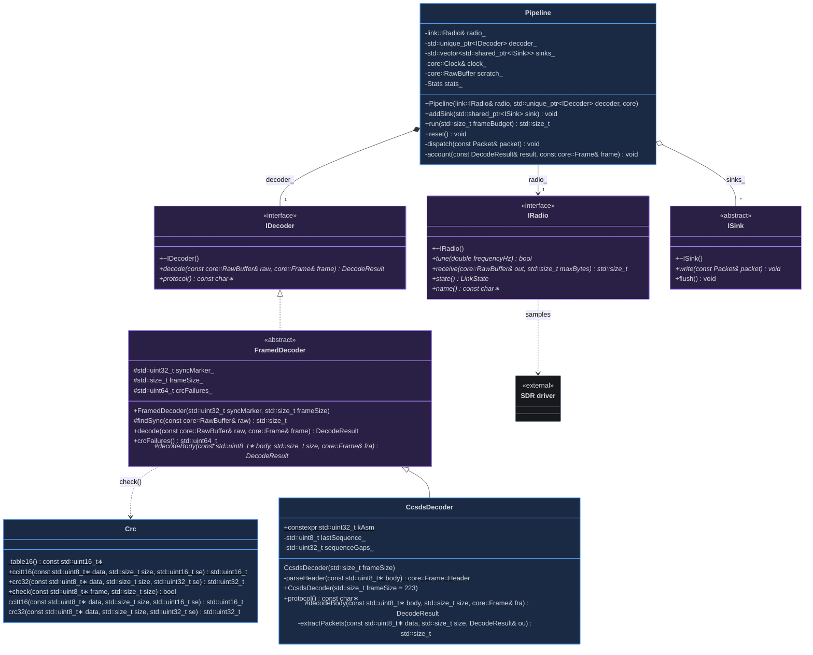

<!-- nncq uml export: generator=1.2 repo=orbitkit view=downlink-path view_rev=0ea498376d4d100e model_hash=0ea498376d4d100e -->
### How a frame becomes packets

Elements ([open this view](http://127.0.0.1:8765/views#/uml/view/view%3Adownlink-path?view=downlink-path&v=0ea498376d4d100e&repo=orbitkit)):

- [Pipeline](http://127.0.0.1:8765/views#/uml/class/sym%3Aorbitkit%3A%3Atelemetry%3A%3APipeline?view=downlink-path&v=0ea498376d4d100e&h=ff1f8df964&repo=orbitkit) class `libs/telemetry/include/orbitkit/telemetry/Pipeline.h:17`
  - [Pipeline()](http://127.0.0.1:8765/views#/uml/method/sym%3Aorbitkit%3A%3Atelemetry%3A%3APipeline%3A%3APipeline?view=downlink-path&v=0ea498376d4d100e&repo=orbitkit) `libs/telemetry/src/Pipeline.cpp:15`
  - [addSink()](http://127.0.0.1:8765/views#/uml/method/sym%3Aorbitkit%3A%3Atelemetry%3A%3APipeline%3A%3AaddSink?view=downlink-path&v=0ea498376d4d100e&repo=orbitkit) `libs/telemetry/src/Pipeline.cpp:21`
  - [run()](http://127.0.0.1:8765/views#/uml/method/sym%3Aorbitkit%3A%3Atelemetry%3A%3APipeline%3A%3Arun?view=downlink-path&v=0ea498376d4d100e&repo=orbitkit) `libs/telemetry/src/Pipeline.cpp:26`
  - [reset()](http://127.0.0.1:8765/views#/uml/method/sym%3Aorbitkit%3A%3Atelemetry%3A%3APipeline%3A%3Areset?view=downlink-path&v=0ea498376d4d100e&repo=orbitkit) `libs/telemetry/src/Pipeline.cpp:66`
  - [dispatch()](http://127.0.0.1:8765/views#/uml/method/sym%3Aorbitkit%3A%3Atelemetry%3A%3APipeline%3A%3Adispatch?view=downlink-path&v=0ea498376d4d100e&repo=orbitkit) `libs/telemetry/src/Pipeline.cpp:49`
  - [account()](http://127.0.0.1:8765/views#/uml/method/sym%3Aorbitkit%3A%3Atelemetry%3A%3APipeline%3A%3Aaccount?view=downlink-path&v=0ea498376d4d100e&repo=orbitkit) `libs/telemetry/src/Pipeline.cpp:55`
  - [radio_](http://127.0.0.1:8765/views#/uml/member/sym%3Aorbitkit%3A%3Atelemetry%3A%3APipeline%3A%3Aradio_?view=downlink-path&v=0ea498376d4d100e&repo=orbitkit) `libs/telemetry/include/orbitkit/telemetry/Pipeline.h:42`
  - [decoder_](http://127.0.0.1:8765/views#/uml/member/sym%3Aorbitkit%3A%3Atelemetry%3A%3APipeline%3A%3Adecoder_?view=downlink-path&v=0ea498376d4d100e&repo=orbitkit) `libs/telemetry/include/orbitkit/telemetry/Pipeline.h:43`
  - [sinks_](http://127.0.0.1:8765/views#/uml/member/sym%3Aorbitkit%3A%3Atelemetry%3A%3APipeline%3A%3Asinks_?view=downlink-path&v=0ea498376d4d100e&repo=orbitkit) `libs/telemetry/include/orbitkit/telemetry/Pipeline.h:44`
  - [clock_](http://127.0.0.1:8765/views#/uml/member/sym%3Aorbitkit%3A%3Atelemetry%3A%3APipeline%3A%3Aclock_?view=downlink-path&v=0ea498376d4d100e&repo=orbitkit) `libs/telemetry/include/orbitkit/telemetry/Pipeline.h:45`
  - [scratch_](http://127.0.0.1:8765/views#/uml/member/sym%3Aorbitkit%3A%3Atelemetry%3A%3APipeline%3A%3Ascratch_?view=downlink-path&v=0ea498376d4d100e&repo=orbitkit) `libs/telemetry/include/orbitkit/telemetry/Pipeline.h:46`
  - [stats_](http://127.0.0.1:8765/views#/uml/member/sym%3Aorbitkit%3A%3Atelemetry%3A%3APipeline%3A%3Astats_?view=downlink-path&v=0ea498376d4d100e&repo=orbitkit) `libs/telemetry/include/orbitkit/telemetry/Pipeline.h:47`
- [IRadio](http://127.0.0.1:8765/views#/uml/interface/sym%3Aorbitkit%3A%3Alink%3A%3AIRadio?view=downlink-path&v=0ea498376d4d100e&h=62da90376b&repo=orbitkit) interface `libs/link/include/orbitkit/link/Radio.h:11`
  - [~IRadio()](http://127.0.0.1:8765/views#/uml/method/sym%3Aorbitkit%3A%3Alink%3A%3AIRadio%3A%3A~IRadio?view=downlink-path&v=0ea498376d4d100e&repo=orbitkit) `libs/link/include/orbitkit/link/Radio.h:13`
  - [tune()](http://127.0.0.1:8765/views#/uml/method/sym%3Aorbitkit%3A%3Alink%3A%3AIRadio%3A%3Atune?view=downlink-path&v=0ea498376d4d100e&repo=orbitkit) `libs/link/include/orbitkit/link/Radio.h:15`
  - [receive()](http://127.0.0.1:8765/views#/uml/method/sym%3Aorbitkit%3A%3Alink%3A%3AIRadio%3A%3Areceive?view=downlink-path&v=0ea498376d4d100e&repo=orbitkit) `libs/link/include/orbitkit/link/Radio.h:17`
  - [state()](http://127.0.0.1:8765/views#/uml/method/sym%3Aorbitkit%3A%3Alink%3A%3AIRadio%3A%3Astate?view=downlink-path&v=0ea498376d4d100e&repo=orbitkit) `libs/link/include/orbitkit/link/Radio.h:18`
  - [name()](http://127.0.0.1:8765/views#/uml/method/sym%3Aorbitkit%3A%3Alink%3A%3AIRadio%3A%3Aname?view=downlink-path&v=0ea498376d4d100e&repo=orbitkit) `libs/link/include/orbitkit/link/Radio.h:19`
- [IDecoder](http://127.0.0.1:8765/views#/uml/interface/sym%3Aorbitkit%3A%3Atelemetry%3A%3AIDecoder?view=downlink-path&v=0ea498376d4d100e&h=1a4aca51f7&repo=orbitkit) interface `libs/telemetry/include/orbitkit/telemetry/Decoder.h:21`
  - [~IDecoder()](http://127.0.0.1:8765/views#/uml/method/sym%3Aorbitkit%3A%3Atelemetry%3A%3AIDecoder%3A%3A~IDecoder?view=downlink-path&v=0ea498376d4d100e&repo=orbitkit) `libs/telemetry/include/orbitkit/telemetry/Decoder.h:23`
  - [decode()](http://127.0.0.1:8765/views#/uml/method/sym%3Aorbitkit%3A%3Atelemetry%3A%3AIDecoder%3A%3Adecode?view=downlink-path&v=0ea498376d4d100e&repo=orbitkit) `libs/telemetry/include/orbitkit/telemetry/Decoder.h:25`
  - [protocol()](http://127.0.0.1:8765/views#/uml/method/sym%3Aorbitkit%3A%3Atelemetry%3A%3AIDecoder%3A%3Aprotocol?view=downlink-path&v=0ea498376d4d100e&repo=orbitkit) `libs/telemetry/include/orbitkit/telemetry/Decoder.h:26`
- [FramedDecoder](http://127.0.0.1:8765/views#/uml/class/sym%3Aorbitkit%3A%3Atelemetry%3A%3AFramedDecoder?view=downlink-path&v=0ea498376d4d100e&h=7e0bb49180&repo=orbitkit) class `libs/telemetry/include/orbitkit/telemetry/Decoder.h:31`
  - [FramedDecoder()](http://127.0.0.1:8765/views#/uml/method/sym%3Aorbitkit%3A%3Atelemetry%3A%3AFramedDecoder%3A%3AFramedDecoder?view=downlink-path&v=0ea498376d4d100e&repo=orbitkit) `libs/telemetry/src/Decoder.cpp:7`
  - [findSync()](http://127.0.0.1:8765/views#/uml/method/sym%3Aorbitkit%3A%3Atelemetry%3A%3AFramedDecoder%3A%3AfindSync?view=downlink-path&v=0ea498376d4d100e&repo=orbitkit) `libs/telemetry/src/Decoder.cpp:12`
  - [decode()](http://127.0.0.1:8765/views#/uml/method/sym%3Aorbitkit%3A%3Atelemetry%3A%3AFramedDecoder%3A%3Adecode?view=downlink-path&v=0ea498376d4d100e&repo=orbitkit) `libs/telemetry/src/Decoder.cpp:23`
  - [crcFailures()](http://127.0.0.1:8765/views#/uml/method/sym%3Aorbitkit%3A%3Atelemetry%3A%3AFramedDecoder%3A%3AcrcFailures?view=downlink-path&v=0ea498376d4d100e&repo=orbitkit) `libs/telemetry/include/orbitkit/telemetry/Decoder.h:37`
  - [decodeBody()](http://127.0.0.1:8765/views#/uml/method/sym%3Aorbitkit%3A%3Atelemetry%3A%3AFramedDecoder%3A%3AdecodeBody?view=downlink-path&v=0ea498376d4d100e&repo=orbitkit) `libs/telemetry/include/orbitkit/telemetry/Decoder.h:40`
  - [syncMarker_](http://127.0.0.1:8765/views#/uml/member/sym%3Aorbitkit%3A%3Atelemetry%3A%3AFramedDecoder%3A%3AsyncMarker_?view=downlink-path&v=0ea498376d4d100e&repo=orbitkit) `libs/telemetry/include/orbitkit/telemetry/Decoder.h:44`
  - [frameSize_](http://127.0.0.1:8765/views#/uml/member/sym%3Aorbitkit%3A%3Atelemetry%3A%3AFramedDecoder%3A%3AframeSize_?view=downlink-path&v=0ea498376d4d100e&repo=orbitkit) `libs/telemetry/include/orbitkit/telemetry/Decoder.h:45`
  - [crcFailures_](http://127.0.0.1:8765/views#/uml/member/sym%3Aorbitkit%3A%3Atelemetry%3A%3AFramedDecoder%3A%3AcrcFailures_?view=downlink-path&v=0ea498376d4d100e&repo=orbitkit) `libs/telemetry/include/orbitkit/telemetry/Decoder.h:46`
- [CcsdsDecoder](http://127.0.0.1:8765/views#/uml/class/sym%3Aorbitkit%3A%3Atelemetry%3A%3ACcsdsDecoder?view=downlink-path&v=0ea498376d4d100e&h=1b7d2d993e&repo=orbitkit) class `libs/telemetry/include/orbitkit/telemetry/CcsdsDecoder.h:7`
  - [CcsdsDecoder()](http://127.0.0.1:8765/views#/uml/method/sym%3Aorbitkit%3A%3Atelemetry%3A%3ACcsdsDecoder%3A%3ACcsdsDecoder?view=downlink-path&v=0ea498376d4d100e&repo=orbitkit) `libs/telemetry/src/CcsdsDecoder.cpp:5`
  - [parseHeader()](http://127.0.0.1:8765/views#/uml/method/sym%3Aorbitkit%3A%3Atelemetry%3A%3ACcsdsDecoder%3A%3AparseHeader?view=downlink-path&v=0ea498376d4d100e&repo=orbitkit) `libs/telemetry/src/CcsdsDecoder.cpp:7`
  - [kAsm](http://127.0.0.1:8765/views#/uml/member/sym%3Aorbitkit%3A%3Atelemetry%3A%3ACcsdsDecoder%3A%3AkAsm?view=downlink-path&v=0ea498376d4d100e&repo=orbitkit) `libs/telemetry/include/orbitkit/telemetry/CcsdsDecoder.h:9`
  - [CcsdsDecoder()](http://127.0.0.1:8765/views#/uml/method/sym%3Aorbitkit%3A%3Atelemetry%3A%3ACcsdsDecoder%3A%3ACcsdsDecoder?view=downlink-path&v=0ea498376d4d100e&repo=orbitkit) `libs/telemetry/include/orbitkit/telemetry/CcsdsDecoder.h:11`
  - [protocol()](http://127.0.0.1:8765/views#/uml/method/sym%3Aorbitkit%3A%3Atelemetry%3A%3ACcsdsDecoder%3A%3Aprotocol?view=downlink-path&v=0ea498376d4d100e&repo=orbitkit) `libs/telemetry/include/orbitkit/telemetry/CcsdsDecoder.h:13`
  - [decodeBody()](http://127.0.0.1:8765/views#/uml/method/sym%3Aorbitkit%3A%3Atelemetry%3A%3ACcsdsDecoder%3A%3AdecodeBody?view=downlink-path&v=0ea498376d4d100e&repo=orbitkit) `libs/telemetry/src/CcsdsDecoder.cpp:37`
  - [extractPackets()](http://127.0.0.1:8765/views#/uml/method/sym%3Aorbitkit%3A%3Atelemetry%3A%3ACcsdsDecoder%3A%3AextractPackets?view=downlink-path&v=0ea498376d4d100e&repo=orbitkit) `libs/telemetry/src/CcsdsDecoder.cpp:17`
  - [lastSequence_](http://127.0.0.1:8765/views#/uml/member/sym%3Aorbitkit%3A%3Atelemetry%3A%3ACcsdsDecoder%3A%3AlastSequence_?view=downlink-path&v=0ea498376d4d100e&repo=orbitkit) `libs/telemetry/include/orbitkit/telemetry/CcsdsDecoder.h:22`
  - [sequenceGaps_](http://127.0.0.1:8765/views#/uml/member/sym%3Aorbitkit%3A%3Atelemetry%3A%3ACcsdsDecoder%3A%3AsequenceGaps_?view=downlink-path&v=0ea498376d4d100e&repo=orbitkit) `libs/telemetry/include/orbitkit/telemetry/CcsdsDecoder.h:23`
- [Crc](http://127.0.0.1:8765/views#/uml/class/sym%3Aorbitkit%3A%3Acore%3A%3ACrc?view=downlink-path&v=0ea498376d4d100e&h=a393d804e2&repo=orbitkit) class `libs/core/include/orbitkit/core/Crc.h:9`
  - [table16()](http://127.0.0.1:8765/views#/uml/method/sym%3Aorbitkit%3A%3Acore%3A%3ACrc%3A%3Atable16?view=downlink-path&v=0ea498376d4d100e&repo=orbitkit) `libs/core/src/Crc.cpp:7`