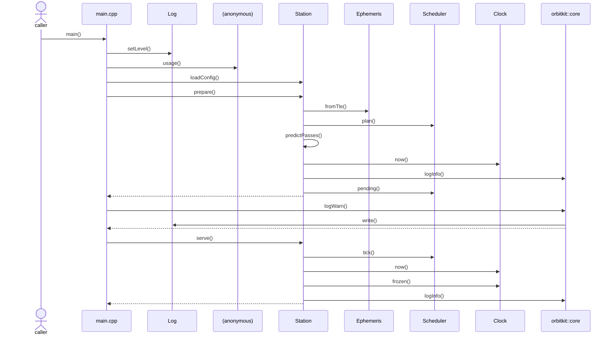

<!-- nncq uml export: generator=1.2 repo=orbitkit view=sequence:main|depth=2&path=apps/groundd/main.cpp view_rev=67c98293af29b979 model_hash=67c98293af29b979 -->
### Sequence: main

Elements ([open this view](http://127.0.0.1:8765/views#/uml/view/view%3Asequence%3Amain%7Cdepth%3D2%26path%3Dapps%2Fgroundd%2Fmain.cpp?view=sequence%3Amain%7Cdepth%3D2%26path%3Dapps%2Fgroundd%2Fmain.cpp&v=67c98293af29b979&repo=orbitkit)):

- caller (bespoke)
- main.cpp (bespoke)
- [Log](http://127.0.0.1:8765/views#/uml/lifeline/sym%3Aorbitkit%3A%3Acore%3A%3ALog?view=sequence%3Amain%7Cdepth%3D2%26path%3Dapps%2Fgroundd%2Fmain.cpp&v=67c98293af29b979&h=d97ebc26d0&repo=orbitkit) lifeline `libs/core/include/orbitkit/core/Log.h:9`
- (anonymous) (bespoke)
- [Station](http://127.0.0.1:8765/views#/uml/lifeline/sym%3Aorbitkit%3A%3Aapp%3A%3AStation?view=sequence%3Amain%7Cdepth%3D2%26path%3Dapps%2Fgroundd%2Fmain.cpp&v=67c98293af29b979&h=f6f8599c06&repo=orbitkit) lifeline `apps/groundd/Station.h:27`
- [Ephemeris](http://127.0.0.1:8765/views#/uml/lifeline/sym%3Aorbitkit%3A%3Asched%3A%3AEphemeris?view=sequence%3Amain%7Cdepth%3D2%26path%3Dapps%2Fgroundd%2Fmain.cpp&v=67c98293af29b979&h=e652ef30d4&repo=orbitkit) lifeline `libs/sched/include/orbitkit/sched/Ephemeris.h:24`
- [Scheduler](http://127.0.0.1:8765/views#/uml/lifeline/sym%3Aorbitkit%3A%3Asched%3A%3AScheduler?view=sequence%3Amain%7Cdepth%3D2%26path%3Dapps%2Fgroundd%2Fmain.cpp&v=67c98293af29b979&h=3a046dfb10&repo=orbitkit) lifeline `libs/sched/include/orbitkit/sched/Scheduler.h:16`
- [Clock](http://127.0.0.1:8765/views#/uml/lifeline/sym%3Aorbitkit%3A%3Acore%3A%3AClock?view=sequence%3Amain%7Cdepth%3D2%26path%3Dapps%2Fgroundd%2Fmain.cpp&v=67c98293af29b979&h=04cab65510&repo=orbitkit) lifeline `libs/core/include/orbitkit/core/Clock.h:8`
- orbitkit::core (bespoke)

Calls:

- [main](http://127.0.0.1:8765/views#/uml/method/sym%3Amain?view=sequence%3Amain%7Cdepth%3D2%26path%3Dapps%2Fgroundd%2Fmain.cpp&v=67c98293af29b979&repo=orbitkit) `apps/groundd/main.cpp:1`
- [orbitkit::core::Log::setLevel](http://127.0.0.1:8765/views#/uml/method/sym%3Aorbitkit%3A%3Acore%3A%3ALog%3A%3AsetLevel?view=sequence%3Amain%7Cdepth%3D2%26path%3Dapps%2Fgroundd%2Fmain.cpp&v=67c98293af29b979&repo=orbitkit) `libs/core/src/Log.cpp:35`
- [(anonymous)::usage](http://127.0.0.1:8765/views#/uml/method/sym%3A%28anonymous%29%3A%3Ausage?view=sequence%3Amain%7Cdepth%3D2%26path%3Dapps%2Fgroundd%2Fmain.cpp&v=67c98293af29b979&repo=orbitkit) `apps/groundd/main.cpp:17`
- [orbitkit::app::Station::loadConfig](http://127.0.0.1:8765/views#/uml/method/sym%3Aorbitkit%3A%3Aapp%3A%3AStation%3A%3AloadConfig?view=sequence%3Amain%7Cdepth%3D2%26path%3Dapps%2Fgroundd%2Fmain.cpp&v=67c98293af29b979&repo=orbitkit) `apps/groundd/Station.cpp:95`
- [orbitkit::app::Station::prepare](http://127.0.0.1:8765/views#/uml/method/sym%3Aorbitkit%3A%3Aapp%3A%3AStation%3A%3Aprepare?view=sequence%3Amain%7Cdepth%3D2%26path%3Dapps%2Fgroundd%2Fmain.cpp&v=67c98293af29b979&repo=orbitkit) `apps/groundd/Station.cpp:69`
- [orbitkit::sched::Ephemeris::fromTle](http://127.0.0.1:8765/views#/uml/method/sym%3Aorbitkit%3A%3Asched%3A%3AEphemeris%3A%3AfromTle?view=sequence%3Amain%7Cdepth%3D2%26path%3Dapps%2Fgroundd%2Fmain.cpp&v=67c98293af29b979&repo=orbitkit) `libs/sched/src/Ephemeris.cpp:23`
- [orbitkit::sched::Scheduler::plan](http://127.0.0.1:8765/views#/uml/method/sym%3Aorbitkit%3A%3Asched%3A%3AScheduler%3A%3Aplan?view=sequence%3Amain%7Cdepth%3D2%26path%3Dapps%2Fgroundd%2Fmain.cpp&v=67c98293af29b979&repo=orbitkit) `libs/sched/src/Scheduler.cpp:17`
- [orbitkit::app::Station::predictPasses](http://127.0.0.1:8765/views#/uml/method/sym%3Aorbitkit%3A%3Aapp%3A%3AStation%3A%3ApredictPasses?view=sequence%3Amain%7Cdepth%3D2%26path%3Dapps%2Fgroundd%2Fmain.cpp&v=67c98293af29b979&repo=orbitkit) `apps/groundd/Station.cpp:49`
- [orbitkit::core::Clock::now](http://127.0.0.1:8765/views#/uml/method/sym%3Aorbitkit%3A%3Acore%3A%3AClock%3A%3Anow?view=sequence%3Amain%7Cdepth%3D2%26path%3Dapps%2Fgroundd%2Fmain.cpp&v=67c98293af29b979&repo=orbitkit) `libs/core/src/Clock.cpp:10`
- [orbitkit::core::logInfo](http://127.0.0.1:8765/views#/uml/method/sym%3Aorbitkit%3A%3Acore%3A%3AlogInfo?view=sequence%3Amain%7Cdepth%3D2%26path%3Dapps%2Fgroundd%2Fmain.cpp&v=67c98293af29b979&repo=orbitkit) `libs/core/src/Log.cpp:45`
- [orbitkit::sched::Scheduler::pending](http://127.0.0.1:8765/views#/uml/method/sym%3Aorbitkit%3A%3Asched%3A%3AScheduler%3A%3Apending?view=sequence%3Amain%7Cdepth%3D2%26path%3Dapps%2Fgroundd%2Fmain.cpp&v=67c98293af29b979&repo=orbitkit) `libs/sched/src/Scheduler.cpp:25`
- [orbitkit::core::logWarn](http://127.0.0.1:8765/views#/uml/method/sym%3Aorbitkit%3A%3Acore%3A%3AlogWarn?view=sequence%3Amain%7Cdepth%3D2%26path%3Dapps%2Fgroundd%2Fmain.cpp&v=67c98293af29b979&repo=orbitkit) `libs/core/src/Log.cpp:50`
- [orbitkit::core::Log::write](http://127.0.0.1:8765/views#/uml/method/sym%3Aorbitkit%3A%3Acore%3A%3ALog%3A%3Awrite?view=sequence%3Amain%7Cdepth%3D2%26path%3Dapps%2Fgroundd%2Fmain.cpp&v=67c98293af29b979&repo=orbitkit) `libs/core/src/Log.cpp:26`
- [orbitkit::app::Station::serve](http://127.0.0.1:8765/views#/uml/method/sym%3Aorbitkit%3A%3Aapp%3A%3AStation%3A%3Aserve?view=sequence%3Amain%7Cdepth%3D2%26path%3Dapps%2Fgroundd%2Fmain.cpp&v=67c98293af29b979&repo=orbitkit) `apps/groundd/Station.cpp:81`
- [orbitkit::sched::Scheduler::tick](http://127.0.0.1:8765/views#/uml/method/sym%3Aorbitkit%3A%3Asched%3A%3AScheduler%3A%3Atick?view=sequence%3Amain%7Cdepth%3D2%26path%3Dapps%2Fgroundd%2Fmain.cpp&v=67c98293af29b979&repo=orbitkit) `libs/sched/src/Scheduler.cpp:53`
- [orbitkit::core::Clock::frozen](http://127.0.0.1:8765/views#/uml/method/sym%3Aorbitkit%3A%3Acore%3A%3AClock%3A%3Afrozen?view=sequence%3Amain%7Cdepth%3D2%26path%3Dapps%2Fgroundd%2Fmain.cpp&v=67c98293af29b979&repo=orbitkit) `libs/core/include/orbitkit/core/Clock.h:20`
